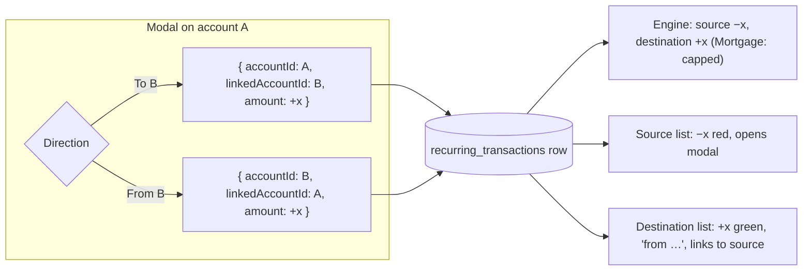

# 29 — Live-Use Repair — Round 1

## Background

Horizon has been in real personal use since 1.2.0. Defects found in that use
are collected in `docs/live-use-defects.md` and reviewed in rounds. Round 1
(defects #1–#4) was frozen at the 2026-10-15 backlog grill, which already
answered the headline question for each. Defect #5 was found during this
session and added to Round 1 by the user's decision (Q3):

| #   | Defect                                          | Class        | Backlog-grill answer                                    |
| --- | ----------------------------------------------- | ------------ | ------------------------------------------------------- |
| 1   | Recurring transfer rejects `-500`; shows `+955` | product gap  | Direction control on entry; signed, mirrored display    |
| 2   | Mortgage Countdown absent on a fresh database   | product gap  | Empty state + one-flow mortgage/origination/repayment   |
| 3   | Duplicate `CategorySelect` ids                  | never-worked | Already fixed 2026-08-04 (`useId()`), locked by 3 tests |
| 4   | Outlook accordion hides per-account balances    | product gap  | Rename to "Projection"; per-account columns, sortOrder  |
| 5   | Outlook counts every Restschuld drop as ST      | product gap  | Sondertilgung from `deriveSTMonths`, capped at payoff   |

This session settled everything below those answers: data flow, file
placement, names, validation, and the places the codebase disagrees with the
decisions already taken.

Code read for this session:

- `src/types/recurring.ts` — a Recurring Transfer is **one** row on the source
  account with `linkedAccountId`.
- `server/src/lib/projection/projection.ts:83` `applyRecurringToBalances` —
  subtracts `r.amount` from the source and adds it to the destination; for a
  Mortgage destination it debits `Math.min(Math.abs(r.amount), remaining)`, so
  **any** transfer into a Mortgage — monthly rate or Sondertilgung — reduces
  Restschuld.
- `RecurringTransactionModal.tsx:87` (positive-only guard) and `:218` (the
  "Per the ST-only model, only Sondertilgung payments should link to a
  Mortgage account" warning).
- `RecurringTransactionList.tsx:69` — `<Money cents={rt.amount} sign />`.
- `useRecurringTransactions.ts:57` — filters `rt.accountId === accountId`, so
  the destination never sees the transfer.
- `src/utils/recurring/recurring.ts:24` `recurringNetPerMonth` — sums raw
  `r.amount`, so the same transfer is `+500` in the stat strip and `−500` in
  the engine (logged as a Live-Use Repair concern by design log 28, Q7).
- `MortgageCountdown.tsx:75` — `return null` with no Mortgage account.
- `MortgageModal.tsx` — `PATCH /accounts/:id/mortgage` for origination only.
- `ProjectionAccordion.tsx` and `src/utils/accordion/accordion.ts` — treat
  **every** month-over-month Restschuld step-down as a Sondertilgung.
- `src/utils/projection/projection.ts:24` `buildAccountColumns` — still
  present, sorts by a `KIND_ORDER` that predates `sortOrder`.
- `server/src/storage/sqlite/accounts.ts:82,118` — accounts are already
  returned `ORDER BY sort_order`.
- `src/features/manual/manualContent/manualContent.ts` — the in-app manual
  describes all four behaviours as they are today (lines 78, 140, 220, 232,
  367, 371).

## Problem

Fix defects #1, #2 and #4 at the edges, as decided, without changing the
stored recurring model or the projection engine, and keep every surface that
describes or derives from them — the stat strip, the manual, the Sondertilgung
highlight — telling the same story. Close #3 as already fixed.

## Questions and Answers

### Scope

1. **Is #3 part of this epic's work?**
   ✅ No work — it is recorded as done. The fix (`useId()` in
   `CategorySelect`) and its three tests landed 2026-08-04. The PRD lists it
   as closed so the round reads complete.

2. **Does Round 1 need an E2E harness?** (the roadmap left this to "the
   finished list")
   ✅ No. Every open defect is component- or route-level: a modal's
   payload, a list's rendering, a card's empty branch, an atomic storage
   write, an accordion's columns. Each is fully reachable by Vitest +
   Testing Library and the existing route tests. Nothing crosses the
   Electron/utility-process boundary. ❌ Playwright/Electron harness —
   build cost with no defect in this round that needs it. Re-decided per
   round.

3. **A new defect surfaced while reading the code — the Outlook summary's
   "total Sondertilgung" counts every Restschuld step-down, so a monthly
   repayment transfer is reported as twelve Sondertilgungen a year. Round 1
   or later?**
   First answer: logged as Round 2, defect #5, because Round 1 was frozen.
   **Revised by the user in the same session:** ✅ **Round 1, defect #5.**
   The user asked whether counting the monthly rate as Sondertilgung is
   really wrong — it is a fixed contractual payment, with an optional
   yearly Sondertilgung of up to €6,500 on top. It is wrong for what the
   tile claims to report: Sondertilgung is the optional extra, the monthly
   rate is the **Darlehen**. With the real setup (€955/month, €6,500 each
   November, payoff ≈ Oct 2031) the tile reads about −€90,000 over 60+
   "annual payments" — the whole Restschuld — instead of about −€32,500
   over 5. Two reasons put it in Round 1 rather than Round 2: the fix is
   small (a correct ST source, `deriveSTMonths`, already exists), and
   Round 1 itself makes the bug universal — defect #2's Mortgage Setup turns
   a monthly Repayment Transfer into the default path. The freeze rule
   stands for future rounds; this is a deliberate, recorded exception. The
   accordion's Sondertilgung highlight has the same root cause and is fixed
   by the same rule (Q26, Q29).

4. **Does the in-app manual change with the behaviour?**
   ✅ Yes, in the same phase as each behaviour change. Design log 28's
   App-Wins Rule makes the manual describe Horizon as it behaves; leaving the
   copy behind would make the manual wrong the moment Round 1 ships. Each
   phase's tests assert the new copy in `manualContent.test.ts` where the
   existing tests already pin sentences.

### Defect #1 — Recurring transfer direction and display

5. **Where does the direction control sit on `RecurringTransactionModal`?**
   ✅ Replace the single "Transfer to account (optional)" select with two
   fields that appear together:
   - **Transfer** select — "— None" or another account (same options as
     today).
   - **Direction** — a `ChoiceChip` pair, "To" / "From", shown only once an
     account is chosen. Default "To".

   This is the pattern `TransactionEditModal.tsx:196` already uses for
   one-off Outflow/Inflow (`FormField label="Direction"` + `StyledChipRow` of
   `ChoiceChip`s), so the two transfer surfaces read alike. ❌ A signed amount
   that implies direction — rejected at the backlog grill (needs a different
   data model). ❌ A `Select` for direction — two options read better as
   chips, and chips are the house pattern.

6. **What does "From" mean for the stored row?**
   ✅ The row's owner flips. On account A with "From B", the modal emits
   `accountId: B, linkedAccountId: A` — the stored shape is unchanged: one
   row on the **source** account. The single-row model and the engine are
   untouched, as decided.

7. **How does the owner reach the server?**
   ✅ `RecurringFormPayload` gains a required `accountId` — the source
   account — and the modal always sets it (the viewed account for a plain
   recurring or a "To" transfer; the chosen account for "From").
   `useRecurringTransactions.create` stops overwriting it
   (`{ ...payload, accountId }` → `{ ...payload }`), and its local
   `CreatePayload`/`UpdatePayload` interfaces gain `accountId`.
   `RecurringTransactionUpdateSchema` gains `accountId: z.string().min(1)
.optional()` so flipping direction on edit is a single `PATCH`.
   ❌ Deriving the owner server-side from a `direction` field — puts a UI
   concept into the API and the stored model.

8. **Can direction be flipped when editing an existing transfer?**
   ✅ Yes. Flipping "To" → "From" moves ownership to the other account; after
   save the row leaves this account's owned list and reappears here as a
   mirrored row (Q11). ❌ Lock direction on edit — forces delete-and-recreate
   for a mistake the form made easy to make.

9. **Amount sign rules?**
   ✅ A **transfer** amount is always typed positive; the sign follows the
   direction. The modal's guard stays, re-worded: "Enter the transfer amount
   as a positive number — the direction sets which way it moves." A **plain**
   recurring keeps signed entry (negative out, positive in) — unchanged, out
   of scope. On edit, a transfer's amount field is seeded with
   `Math.abs(amount)`.

10. **Is positive-only also enforced server-side?**
    ✅ Yes. `RecurringTransactionCreateSchema` gets a `superRefine`: with
    `linkedAccountId` set, `amount > 0` and `linkedAccountId !== accountId`.
    `PATCH /recurring-transactions/:id` checks the **merged** row (stored +
    patch) for the same two rules before writing. Both answer with
    `{ issues }`, the route's existing error shape. No migration: the modal
    has rejected non-positive transfers since `d2109d2` (2026-04-19), so a
    negative linked row can only exist if written around the UI; such a row
    is normalised on its next save via the modal.

11. **How does the destination account see the transfer?**
    ✅ `useRecurringTransactions(accountId)` returns rows where
    `rt.accountId === accountId || rt.linkedAccountId === accountId`. The
    list classifies each row against the viewed account:

    | Row relation to viewed account | Amount shown      | Linked line         | Clickable                    |
    | ------------------------------ | ----------------- | ------------------- | ---------------------------- |
    | Owned, plain                   | `amount` (signed) | —                   | opens modal                  |
    | Owned, transfer (source)       | `−amount`, red    | `→ ● Mortgage`      | opens modal                  |
    | Mirrored (destination)         | `+amount`, green  | `← ● from Postbank` | links to source account page |

    `RecurringTransactionList` gains an `accountId` prop (the viewed
    account). Red/green comes from `<Money sign />`'s existing gain/loss
    tone — no new styling tokens.

12. **What does "read-only, editable only from the source" look like?**
    ✅ The mirrored `DataRow` gets `to={`/accounts/${rt.accountId}`}` instead
    of `onClick` — `DataRow` already supports `to`. Clicking it takes the user
    to the account where the row can be edited. It never opens the modal.
    ❌ An inert row — "editable only from the source" with no path to the
    source is a dead end. ❌ Editing in place — two places that own one row.

13. **Where does the signed-for-this-account rule live?**
    ✅ One pure helper in `src/utils/recurring/recurring.ts`:

    ```ts
    /**
     * A recurring's amount as it lands on `accountId`, in signed cents: a
     * plain recurring as stored, a Recurring Transfer negative on its source
     * and positive on its destination, 0 for a recurring that does not touch
     * the account.
     */
    export const recurringAmountFor = (
      recurring: RecurringTransaction,
      accountId: string
    ): number;
    ```

    `RecurringTransactionList` renders `recurringAmountFor(rt, accountId)`;
    `recurringNetPerMonth` is rewritten on top of it (filter →
    `recurringAmountFor(...) * PER_MONTH_WEIGHT[...]`), which fixes the
    `+500`/`−500` disagreement design log 28 Q7 refused to document. Exported
    through `src/utils/index.ts` beside `recurringNetPerMonth`; tested in the
    co-located `recurring.test.ts`. The Mortgage cap
    (`Math.min(amount, remaining)`) is engine-only and is **not** reproduced —
    the stat strip is an average of rules, not a simulation.

14. **Does the stat strip's "recurring count" include mirrored rows?**
    ✅ Yes — it counts what the list shows: every recurring that moves this
    account's balance. `AccountDetailPage` already passes
    `recurringTransactions.length`, so this follows from Q11 with no change.

15. **What happens to the "ST-only model" warning on Mortgage links?**
    ✅ Removed, with its test (`RecurringTransactionModal.test.tsx:147-167`
    rewritten to assert its absence). The engine has never followed it — any
    transfer into a Mortgage reduces Restschuld — and defect #2's setup flow
    deliberately creates a **monthly** repayment transfer into the Mortgage,
    which the warning would tell the user is wrong. The glossary retires
    **ST-only Model** (see the ubiquitous-language update). Stale "ST-only
    model" comments in `accordion.ts` and `outlook.ts` are rewritten in the
    phases that touch those files (Phases 1 and 2).

### Defect #2 — Mortgage Countdown empty state and setup flow

16. **Where does the empty state render, and with what?**
    ✅ Inside `MortgageCountdown`, replacing `return null`: a `Card` with the
    same `SectionHead label="Mortgage Countdown"`, holding the shared
    `EmptyState` component (`src/components/EmptyState/`) — icon `Landmark`,
    title "No mortgage yet", hint "Add your mortgage to see what's paid off
    and when it's done.", action `<Button>Set up mortgage</Button>`. No new
    component; `EmptyState` is the house empty state.

17. **Does the empty state appear when other mortgages exist?** / **Do the
    KPI strip's mortgage tiles get an empty state too?**
    ✅ Empty state only when there are **zero** Mortgage accounts. The KPI
    tiles keep hiding: one invitation on the Dashboard, not two. A wider
    "every Empty-Hidden Surface" audit is not in Round 1; it is logged as a
    later-round item only if live use asks for it.

18. **What is the setup flow?**
    ✅ A new modal, `src/features/mortgage/MortgageSetupModal/`
    (`MortgageSetupModal.tsx` / `.test.tsx` / `.styles.ts`), opened by the
    empty state's button. Three groups on one form — no wizard:

    | Group       | Field                | Maps to                             | Rule                                |
    | ----------- | -------------------- | ----------------------------------- | ----------------------------------- |
    | Mortgage    | Name                 | `account.name`                      | required, default "Mortgage"        |
    |             | Restschuld today     | `account.openingBalance`            | > 0                                 |
    |             | As of                | `account.openingDate`               | default today                       |
    | Origination | Original principal   | `originalPrincipal`                 | ≥ Restschuld (existing rule)        |
    |             | Start date           | `startDate`                         | ≤ As of                             |
    |             | Term (years)         | `termYears`                         | integer 1–40                        |
    | Repayment   | Paid from            | repayment `accountId`               | Girokonto or Tagesgeld              |
    |             | Monthly rate         | monthly Recurring Transfer `amount` | > 0                                 |
    |             | Day of month         | `dayOfMonth` (both transfers)       | `Stepper` 1–31, default 1           |
    |             | Annual Sondertilgung | annual Recurring Transfer `amount`  | optional; > 0 when given            |
    |             | in month             | `monthOfYear`                       | required when ST given, default Nov |

    Colour defaults to a random `accountColorPalette` entry, as
    `AccountCreateModal` does; icon is unset. Both colour and icon remain
    editable from the account page afterwards. A live "% paid off" preview
    reuses `percentPaidOff`, as `MortgageModal` shows it.

19. **What if there is no Girokonto or Tagesgeld to pay from?**
    ✅ The Repayment group is replaced by a note — "Add a Girokonto to set up
    the monthly repayment." — and the mortgage is created without transfers.
    The card then shows the no-repayment footer (Q22). ❌ Blocking the whole
    setup — the Restschuld and "% paid off" are worth having on their own.

20. **One request or several?**
    ✅ One: `POST /mortgages`, creating the account, its origination, and up
    to two Recurring Transfers in a single SQLite transaction. Precedent:
    `server/src/storage/sqlite/transfers.ts:35` and `imports.ts:87` already
    wrap multi-row writes in `db.transaction`. Layout follows the routes
    convention:

            ```
            server/src/routes/mortgages/mortgages.ts        ← router
            server/src/routes/mortgages/mortgage.ts         ← MortgageSetupSchema (zod)
            server/src/routes/mortgages/mortgages.test.ts
            server/src/storage/sqlite/mortgages.ts          ← createMortgageRepo(db).create(setup)
            ```

            `Storage` gains `mortgages: { create(setup: MortgageSetup): Promise<

        AccountWithBalance> }`; `MortgageSetup`lives in`server/src/storage/
        types.ts`. Storage tests cover the rollback: a failing recurring insert

    leaves no account behind. The repayment transfers are written with
    category `"Transfer"`(a default category — hideable, never deletable)
    and descriptions "Mortgage repayment" / "Sondertilgung". The route
    answers validation failures with`{ issues }`, matching every other
    route. ❌ Three client-side calls (`POST /accounts`,
    `PATCH /accounts/:id/mortgage`, `POST /recurring-transactions`) — a
    failure mid-way leaves a half-set-up mortgage that the empty state no
    longer offers to fix.

21. **Does `AccountCreateModal` (kind = Mortgage) change?**
    ✅ No. It stays a second, plainer way to add a Mortgage account; the
    pencil edit (`MortgageModal`) and recurring transfers still complete it.
    ❌ Redirecting kind=Mortgage into the setup modal — a change to the
    accounts feature no defect asked for.

22. **What does the card show for a mortgage with no repayment transfer?**
    ✅ The footer reads "No repayment set up — add a recurring transfer into
    this mortgage to see the payoff date." instead of "Not paid off within
    10-year horizon.", which is misleading when nothing is paying it off.
    Detection is a pure helper in `src/utils/mortgage/mortgage.ts`:

    ```ts
    export const hasRepaymentTransfer = (
      recurrings: RecurringTransaction[],
      mortgageId: string
    ): boolean; // some r.linkedAccountId === mortgageId
    ```

    `MortgageCountdown` gains a `recurringTransactions` prop;
    `DashboardPage` already holds them for `TrajectoryHorizon` and
    `PlanSummary`.

23. **Does the setup modal anticipate Balance Anchor?**
    ✅ Only by naming. "Restschuld today / As of" is the Balance Anchor's
    shape (a balance on a date the user knows), stored today as
    `openingBalance` / `openingDate`. Balance Anchor will re-home the fields;
    Round 1 adds no anchor concept.

### Defect #4 — Projection accordion columns

24. **Where do per-account columns come from?**
    ✅ Reuse `buildAccountColumns` (`src/utils/projection/projection.ts:24`)
    with a changed contract: keep the input order (the server's
    `sort_order`) instead of sorting by `KIND_ORDER`, and carry the colour
    for the header chip:

    ```ts
    export interface AccountColumn {
      id: string;
      name: string;
      kind: AccountKind;
      color: string; // resolveAccountColor(account)
    }
    ```

    `KIND_ORDER` is deleted. Every non-Mortgage account is a column,
    including accounts with `showInTrajectory: false` — that flag governs the
    chart, not the table.

25. **What do the year header rows show per account?**
    ✅ The year's closing **projected** balance per account — same rule as
    Total Liquid and Restschuld today. `aggregateYearSummaries`
    (`src/utils/accordion/accordion.ts`) changes shape:

    ```ts
    export interface YearAggPoint {
      month: string;
      totalLiquid: number;
      restschuld: number;
      accounts: Record<string, number>; // projected, per non-Mortgage account
    }

    export interface YearSummary {
      year: number;
      totalLiquid: number;
      restschuld: number;
      accounts: Record<string, number>; // end-of-year
    }
    ```

    `netCashflow` and `sondertilgung` leave both types. ❌ Mixing `actual` in
    — the accordion is a projection view; `restschuldOf`'s comment explains
    why `actual` fabricates a step at the current month.

26. **How is the Sondertilgung month found now?**
    ✅ From `effectiveSTMonths` (Q29) — `deriveSTMonths`' annual Recurring
    Transfers into a Mortgage, cut off at the Payoff Month. `ProjectionAccordion` gains a
    `recurringTransactions` prop to call it; `PlanPage` passes them. The
    step-down detection in the component (`stByMonth`) is deleted. Without
    this, a monthly repayment makes every month a "Sondertilgung month".
    The highlight stays; the amount is no longer printed (its column is
    gone).

27. **Grid and overflow with many accounts?**
    ✅ `StyledColumnHeader`, `StyledYearHeader` and `StyledMonthRow` take an
    `$accountCount` transient prop and build `grid-template-columns` from it
    (chevron · Period · N × account · Total Liquid · Restschuld). The
    accordion body scrolls horizontally inside its card when the columns do
    not fit; Period stays the first column. Header cells for accounts show
    `<Chip color size="sm" />` + name, the `RecurringTransactionList` linked
    line pattern.

28. **Title and skeleton.**
    ✅ `StyledSectionTitle` reads "Projection" in `ProjectionAccordion.tsx`
    and `ProjectionAccordionSkeleton.tsx:35`. The skeleton's column count
    follows the summary shape it mimics (Period · two placeholder account
    columns · Total Liquid · Restschuld); a layout-matched skeleton is the
    #208 CLS rule.

### Defect #5 — Sondertilgung counted from the recurring, not the step-down

29. **What is the single rule for "a Sondertilgung happened"?**
    ✅ A month is an **ST Month** when an annual Repayment Transfer fires in
    it (`deriveSTMonths`) **and** the Mortgage still has Restschuld to pay.
    The engine already behaves this way: after payoff it refunds the
    transfer to the source (`applyRecurringToBalances`, `actualDebit <= 0`),
    so a post-payoff Sondertilgung never happens. One new pure helper beside
    `deriveSTMonths` in `src/utils/projection/projection.ts`:

    ```ts
    /**
     * The Sondertilgung months that actually reduce Restschuld: each
     * deriveSTMonths entry up to and including the Payoff Month, its amount
     * capped at the Restschuld left at the end of the previous month.
     */
    export function effectiveSTMonths(
      stMonths: Map<string, number>,
      snapshots: MonthlySnapshot[],
      mortgageIds: string[]
    ): Map<string, number>;
    ```

    Every Sondertilgung consumer reads it — `ProjectionAccordion` (Q26),
    `OutlookSummary`, `PlanSummary`, `TrajectoryHorizon` — so the four
    surfaces cannot disagree. ❌ Fixing only the Outlook tile — leaves the
    Dashboard `PlanSummary` reporting €6,500 a year for every year after
    payoff, the same false claim from another angle.

30. **How does `OutlookSummary` change?**
    ✅ `deriveOutlookSummary` in `src/utils/outlook/outlook.ts` takes the ST
    map as a second argument and sums/counts it instead of walking
    step-downs:

    ```ts
    export function deriveOutlookSummary(
      points: OutlookPoint[],
      stMonths: Map<string, number> // effectiveSTMonths(...)
    ): OutlookSummary;
    ```

    `OutlookSummary` gains a `recurringTransactions` prop; `PlanPage`
    passes the ones it already fetches for Q26. The tile's label and its
    "N annual payments" hint stay — they become true.

31. **`src/utils/projection/projection.ts` has a second, unused
    `deriveOutlookSummary` that already reads an ST map. Merge them?**
    ✅ Not in Round 1. Two exported functions with one name is a refactor
    concern, not a live-use defect; it goes to `request-refactor-plan` after
    the round, together with `deriveYearSummaries`' overlap with
    `aggregateYearSummaries`. Round 1 changes only the one `OutlookSummary`
    imports.

## Design

### Recurring transfer — one stored row, three readings



### Files

| Defect | File                                                                                  | Change                                                                 |
| ------ | ------------------------------------------------------------------------------------- | ---------------------------------------------------------------------- |
| #1     | `src/features/transactions/RecurringTransactionModal/*`                               | Transfer select + Direction chips; `accountId` in payload; warning out |
| #1     | `src/features/transactions/RecurringTransactionList/*`                                | `accountId` prop; signed amount; mirrored row links to source          |
| #1     | `src/features/transactions/useRecurringTransactions/*`                                | include mirrored rows; payload carries `accountId`                     |
| #1     | `src/utils/recurring/recurring.ts` (+ test, + `utils/index.ts`)                       | `recurringAmountFor`; `recurringNetPerMonth` on top of it              |
| #1     | `src/pages/AccountDetailPage/AccountDetailPage.tsx`                                   | pass `accountId` to the list                                           |
| #1     | `server/src/routes/recurringTransactions/recurringTransaction.ts` (+ route)           | positive + not-self rules on create and merged update                  |
| #2     | `src/features/mortgage/MortgageCountdown/*`                                           | `EmptyState` branch; no-repayment footer; `recurringTransactions` prop |
| #2     | `src/features/mortgage/MortgageSetupModal/*` (new)                                    | one-form setup                                                         |
| #2     | `src/utils/mortgage/mortgage.ts` (+ test)                                             | `hasRepaymentTransfer`                                                 |
| #2     | `server/src/routes/mortgages/*` (new), `server/src/storage/sqlite/mortgages.ts` (new) | atomic `POST /mortgages`                                               |
| #2     | `src/pages/DashboardPage/DashboardPage.tsx`                                           | pass `recurringTransactions`; refetch on setup                         |
| #4     | `src/utils/projection/projection.ts` (+ test)                                         | `buildAccountColumns` keeps order, adds `color`; `KIND_ORDER` out      |
| #4     | `src/utils/accordion/accordion.ts` (+ test)                                           | per-account end-of-year; drop netCashflow/sondertilgung                |
| #4     | `src/features/projection/ProjectionAccordion/*`                                       | "Projection"; account columns; ST from `deriveSTMonths`                |
| #4     | `src/pages/PlanPage/PlanPage.tsx`                                                     | pass `recurringTransactions`                                           |
| #5     | `src/utils/projection/projection.ts` (+ test, + `utils/index.ts`)                     | `effectiveSTMonths`                                                    |
| #5     | `src/utils/outlook/outlook.ts` (+ test)                                               | `deriveOutlookSummary(points, stMonths)`                               |
| #5     | `src/features/projection/OutlookSummary/*`                                            | `recurringTransactions` prop; ST from `effectiveSTMonths`              |
| #5     | `src/features/projection/PlanSummary/*`, `TrajectoryHorizon/*`                        | `deriveSTMonths` → `effectiveSTMonths`                                 |
| all    | `src/features/manual/manualContent/manualContent.ts` (+ test)                         | copy follows each behaviour change                                     |

### Manual copy that changes

- **Recurring transactions / transfers** (lines 367, 371): describe the
  Transfer select + To/From direction, positive amounts, the red/green
  pairing, the mirrored row that links back to its source, and that monthly
  repayments as well as Sondertilgung are modelled as transfers into a
  Mortgage. The "only Sondertilgung should point at a mortgage" sentence and
  the "There is no in/out control" sentence go.
- **Getting started — origination** (line 78) and **Mortgage Countdown**
  (line 140): the empty-state button and the one-form setup, including the
  repayment, and the no-repayment footer.
- **Outlook accordion** (lines 220, 232): "Projection" title, Period · one
  column per account · Total Liquid · Restschuld, Sondertilgung months tinted;
  Net Cashflow and the Sondertilgung column no longer described.
- **Outlook summary**: "Total Sondertilgung" counts only the annual extra
  payments up to payoff; the monthly rate is not Sondertilgung.

## Implementation Plan

1. **Projection columns (#4).** `buildAccountColumns` order + colour,
   `aggregateYearSummaries` reshape, accordion rename/columns/ST highlight
   from `effectiveSTMonths` (the helper lands here, first needed here),
   skeleton, `PlanPage` prop, manual copy. Frontend-only; thinnest slice.
2. **Sondertilgung rule (#5).** `deriveOutlookSummary(points, stMonths)`;
   `OutlookSummary`, `PlanSummary` and `TrajectoryHorizon` switched to
   `effectiveSTMonths`; manual copy.
3. **Transfer display (#1).** `recurringAmountFor`, `recurringNetPerMonth`
   rewrite, mirrored rows in `useRecurringTransactions`, signed/mirrored
   `RecurringTransactionList`, `AccountDetailPage` wiring.
4. **Transfer entry (#1).** Direction chips, `accountId` in payload and
   update schema, server positive/not-self rules, warning removed, manual
   copy for 2 + 3.
5. **Mortgage setup backend (#2).** `MortgageSetupSchema`,
   `storage.mortgages.create` in one `db.transaction`, `POST /mortgages`,
   rollback test.
6. **Mortgage setup UI (#2).** `EmptyState` branch, `MortgageSetupModal`,
   `hasRepaymentTransfer` + footer, `DashboardPage` wiring, manual copy.
7. **Close the round.** Mark #1, #2, #4, #5 resolved in
   `docs/live-use-defects.md` with their commits; tick the roadmap entry.

## Trade-offs

- **Easier:** recurring transfers now read like one-off transfers on both
  accounts, with no migration and no engine change. One signed-amount helper
  feeds both the list and the stat strip, so they cannot disagree again. A
  fresh install leads straight to a working mortgage with a payoff date.
  Sondertilgung means one thing on every surface — the annual extra payment,
  only while there is Restschuld left.
- **Harder:** the accordion now has a variable column count and needs
  horizontal scroll for many accounts. `POST /mortgages` is a second way to
  create a Mortgage account beside `POST /accounts`; both must stay valid
  when Balance Anchor reworks the opening-balance fields.
- **Ruled out:** a signed recurring-transfer pair (rejected at the backlog
  grill — data-model change); an E2E harness (Q2); merging the duplicate
  `deriveOutlookSummary` (Q31, refactor plan); KPI tile empty states and the wider
  Empty-Hidden Surface audit (Q17); changing `AccountCreateModal` (Q21);
  interest modelling (no defect asks for it; payoff stays a projection of
  entered transfers).
