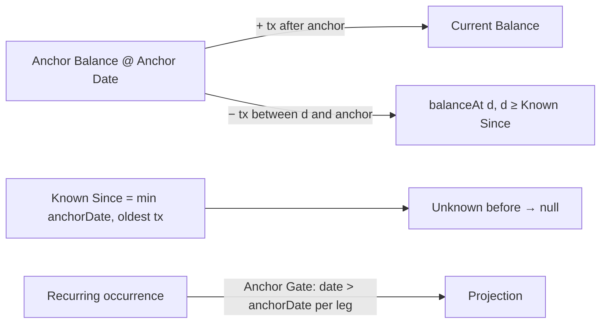

# 30 — Balance Anchor

## Background

Live use found that an account's balance is wrong as soon as past statements
are imported. The user creates a Girokonto with the balance their bank shows
today, imports the last 12 months, and the balance grows by those 12 months'
net. Nothing is missing; the numbers are simply wrong.

The user approved every recommendation below in advance ("do this one alone,
i approve all your recommendations"), so this session was a solo grill: each
question was settled from the code and recorded with its recommended answer.

Code read for this session:

- `server/src/storage/sqlite/accounts.ts:99,113,123` — balance is
  `a.opening_balance + COALESCE(SUM(t.amount), 0)` with no date check, in
  three statements (all, by id, Total Liquid).
- `server/src/lib/projection/projection.ts:143` — the engine starts every
  running balance at `openingBalance`. The Replay Loop (`:152`) fires recurring
  from the **source's** opening month only. `actual` (`:241`) is
  `openingBalance + Σ tx ≤ month`. Non-mortgage accounts are re-anchored to
  `actual` for every month up to the current one (`:256`). Mortgages are not,
  so their Restschuld is the replayed `projected`.
- The replay gate checks only the source leg. A Recurring Transfer into a
  Mortgage whose opening date is later than the Girokonto's is therefore
  replayed from the Girokonto's opening month and comes off a Restschuld that
  was entered as already current. In the forward loop (`:202`), month 0 fires
  every recurring flow for the whole current month, including occurrences
  dated before the day the Restschuld was entered.
- `server/src/routes/projection/projection.ts:76` `GET /projection/history`
  runs the engine from the earliest imported month. `history.ts:56` reads
  `actual ?? 0`, so a month with no data is shown as €0.
- `server/src/lib/settlement/settlement.ts:87` — a CreditCard's closing
  balance is `openingBalance + real + virtual`.
- `server/src/lib/csvImport/flagRows.ts:56` `detectRecurring`. This pre-unchecks
  any imported row that matches a RecurringTransaction, whatever its date.
- `src/utils/savingsGoal/savingsGoal.ts:50` — `point.accounts[id] ?? 0`.
- `AccountCreateModal.tsx` — in edit mode the opening date is shown, but a
  change to it is silently dropped. `AccountUpdateInput` has no `openingDate`,
  and the manual (`manualContent.ts:359`) documents this.
- Glossary: **Opening Balance** is defined with "no backtracking", and
  **Current Balance** as Opening Balance + Recurring History + Variable
  Spending. The storage SQL does neither.

## Problem

Replace "opening balance plus every transaction" with a balance anchored at
one known point in time. Derive history before the anchor and the present
after it. Show unknown months as unknown, never as €0. Keep the projection
engine, settlement and import consistent with that model.

## Questions and Answers

**Q1. Is the anchor a new concept beside Opening Balance/Date, or does it
replace them?**
Replace. Each account has exactly one **Balance Anchor**: an **Anchor
Balance** at an **Anchor Date**. The columns are renamed in place
(`opening_balance` → `anchor_balance`, `opening_date` → `anchor_date`), and the
DTO fields become `anchorBalance` / `anchorDate` across server, API and client.
There are no aliases and no compatibility shim: client and server ship
together, and Horizon has no external API consumers. Keeping the old name would
leave a field called "opening" that means the opposite.

**Q2. One anchor or a history of anchors?**
One. Re-anchoring replaces it. Several anchors could disagree with each other,
and that needs a reconciliation feature nobody asked for.

**Q3. Does the anchor balance include transactions dated on the Anchor Date?**
Yes. The anchor is the balance at the **end of** its date. That matches both
sources the user takes it from: the bank app's balance today (which includes
today's booked rows) and a statement's closing Saldo. A 12-month export taken
today contains today's rows, so counting them on top of today's balance would
add them twice.

**Q4. What is the formula?**
For any date `d`:

```
balanceAt(d) = anchorBalance + Σ tx where anchorDate < date ≤ d     (d ≥ anchorDate)
balanceAt(d) = anchorBalance − Σ tx where d < date ≤ anchorDate     (d < anchorDate)
Current Balance = anchorBalance + Σ tx where date > anchorDate
```

Future-dated transactions still count toward the Current Balance, as they do
today. Adding a cutoff at today is not this epic's change.

**Q5. Where does the math live?**
In two places, each in the style the codebase already uses:

- The **Current Balance** stays in the Storage layer as native SQL (the glossary
  rule for **AccountWithBalance**):
  `a.anchor_balance + COALESCE(SUM(CASE WHEN t.date > a.anchor_date THEN t.amount ELSE 0 END), 0)`.
  This is applied to all three statements in `accounts.ts`.
- A new pure module, `server/src/lib/balanceAnchor/balanceAnchor.ts` with a
  co-located test (the `lib/<name>/<name>.ts` shape, the same as `projection/`
  and `settlement/`), exports `balanceAt` and `knownSince`. The engine and
  settlement both call it. `storage.parity.ts` checks that the SQL Current
  Balance equals `balanceAt(today)`.

**Q6. How far back is a balance known?**
To **Known Since**, the earlier of the Anchor Date and the account's oldest
Transaction date (any source: imported, manual or settlement). That date's
month is the first month with a known balance. Earlier months are **Unknown**.
Horizon trusts that the recorded transactions between Known Since and the
anchor are complete. It cannot tell otherwise, and a statement import is
exactly that claim.

**Q7. Does recurring ever move a balance before the anchor?**
No. This is the **Anchor Gate**: a recurring occurrence moves an account's
balance only if its date (the month at `dayOfMonth`, clamped to the month's
length) is **after** that account's Anchor Date. The gate is checked for each
leg separately. If a Recurring Transfer is gated on the destination leg, the
source leg is still debited (the money left). The gate applies in both the
Replay Loop and the Forward Projection. It fixes the two Mortgage errors under
Background: Restschuld no longer has payments taken off before it was entered,
or taken off twice for a rate already paid this month.

**Q8. Recurring Detection pre-unchecks imported salary and standing-order rows.
Does that still hold before the anchor?**
No. Rows dated on or before the account's Anchor Date are never flagged
`recurring`. The anchor already contains their effect, and the Anchor Gate
means nothing replays them, so excluding them only falsifies the history that
is derived backwards. Rows after the anchor are flagged as before. That
behaviour has its own open tension: the Current Balance after the anchor never
includes skipped recurring flows. It is recorded as a hand-off to **Month Cash
Flow** and is not solved here.

**Q9. What happens to existing accounts?**
Migration `017_rename_opening_to_anchor.sql` renames the two columns only. The
values are reinterpreted, not rewritten:

- Accounts whose opening date precedes all their transactions keep identical
  numbers.
- The live-use case (an account set up today, months imported afterwards)
  repairs itself.
- Edge case: a transaction dated **on** the old opening date was added on top
  before and is now absorbed into the anchor. The user can re-anchor if any
  real account was entered that way. The release notes say so.

**Q10. How does the user re-anchor?**
Through **Account Edit Mode**, with no new surface. `AccountUpdateInput` gains
`anchorDate` beside `anchorBalance`, so the date field the modal already shows
finally saves. The manual's "opening date is fixed at creation" caution is
removed. A "Horizon has €X on this date" reconciliation hint is deferred.

**Q11. What validation applies?**
`anchorDate` must be on or before today. The server rejects a later date with
`400`, using the same `new Date().toISOString().slice(0, 10)` idiom as
`linkedSince`, and the DatePicker caps at today. The existing Mortgage rules
stay: `startDate ≤ anchorDate`, and an original principal no less than the
Restschuld. `linkedSince` still defaults to the Anchor Date when a CreditCard
is created with a funding account.

**Q12. How does an Unknown month travel through the API?**
As `null`, never as an absent key or `0`, so that the compiler makes every
consumer handle it:

- `MonthlySnapshot.accounts[id].actual` is omitted before Known Since. It is
  already optional.
- `HistoryPoint.accounts: Record<string, number | null>`.
- `HistoryPoint.restschuld: number | null` is `null` before the Mortgage's Known
  Since.
- `HistoryPoint.totalLiquid: number | null` sums the liquid accounts known that
  month and is `null` only when none is known. An account before its Known
  Since counts as not yet tracked, like an account that did not exist yet.

No `knownSince` field is added to the API, because the client reads it from the
first non-null point.

**Q13. How does an Unknown month render?**

- **HistoryChart**: `null` breaks the line (no `connectNulls`), and the tooltip
  row reads "No data before {Mon YYYY}".
- **YearArchive**: "—".
- **Savings Streak**: a month where any Tracked Account, in that month or the
  one before, is Unknown is neither met nor missed. The streak and Recent
  Savings Pace skip it.
- No surface ever renders €0 for Unknown. The Dashboard, Outlook and Account
  pages read the current month, which is always on or after Known Since, so
  they need no change.

**Q14. Mortgage history before its anchor?**
Unknown, the same as any account. Deriving the Restschuld back to the Mortgage
Start Date from the Original Principal belongs to **Financial History**.

**Q15. Which names does the user see?**
The account form says **Balance** and **As of**, with the help text "Your
balance at the end of this day, including that day's transactions". That
mirrors Mortgage Setup's "Restschuld today / as of". The Account stat strip
shows **Balance anchor**: the amount and "as of {date}". The code uses
`anchorBalance` / `anchorDate` everywhere, including
`ProjectionAccountEntry`, `MortgageSetup` and `HistoryAccount` where needed.

## Design



- ✅ Rename opening → anchor and reinterpret (Q1, Q9).
  ❌ A new anchor beside the opening balance: two baselines would have no rule
  for which one wins.
- ✅ End-of-day anchor (Q3). ❌ Start-of-day: today's rows would be counted
  twice in the main live-use flow.
- ✅ SQL Current Balance plus a pure `balanceAnchor` lib (Q5).
  ❌ Storing a derived "base" column: it would go stale on every import.
- ✅ Anchor Gate per leg on occurrence date (Q7). ❌ A month-level gate: it
  would double-count a rate already paid this month.
- ✅ No recurring flag on rows dated on or before the anchor (Q8).
  ❌ Synthesising past recurring occurrences: the epic forbids it, and the
  statement is the truth.
- ✅ `null` for Unknown (Q12). ❌ Omitting the key: `?? 0` would quietly
  reintroduce €0.

Files touched:

- `server/src/storage/sqlite/migrations/017_rename_opening_to_anchor.sql`
- `server/src/storage/types.ts`, `server/src/storage/sqlite/{accounts,accountWriters,mortgages}.ts`, `storage.parity.ts`
- `server/src/lib/balanceAnchor/balanceAnchor.ts` (+ `.test.ts`)
- `server/src/lib/projection/{projection,history}.ts`, `server/src/lib/settlement/settlement.ts`
- `server/src/lib/csvImport/flagRows.ts` (+ `buildPreview.ts`, which supplies the anchor date)
- `server/src/routes/{accounts/account,mortgages/mortgage,projection/projection,settlements/settlements}.ts`
- `src/types/account.ts`, `AccountCreateModal`, `AccountStatStrip`, `mortgageSetupForm`, `MortgageCountdown`
- `src/features/history/{historyTypes,HistoryChart,YearArchive}`, `src/utils/savingsGoal/savingsGoal.ts`
- `src/features/manual/manualContent/manualContent.ts`

## Implementation Plan

1. **Anchor model and Current Balance.** Migration 017, the rename end to end,
   the anchored SQL Current Balance, `anchorDate ≤ today`, and an editable
   anchor date in Account Edit Mode with the new labels. This slice fixes the
   live-use case on the Accounts card and Account Hero.
2. **Engine and settlement.** `balanceAnchor` lib (`balanceAt`, `knownSince`).
   `actual` uses `balanceAt` and is omitted before Known Since. The Anchor Gate
   applies in the Replay Loop and the Forward Projection. The settlement
   closing balance uses `balanceAt`.
3. **Import.** `detectRecurring` skips rows dated on or before the target
   account's Anchor Date.
4. **Unknown, not €0.** Nullable `HistoryPoint` fields, `deriveHistory`, line
   breaks and the "No data before …" tooltip in HistoryChart, "—" in
   YearArchive, Savings Streak skipping Unknown months.
5. **Docs.** Manual copy (account form, account page, mortgage), the
   release-notes migration caveat, and the README build status.

## Trade-offs

- **Easier:** one formula answers any date, so Financial History can draw past
  balances without new math. Importing older statements extends history and
  never moves the present. The Mortgage replay bugs are fixed as a side effect.
- **Harder:** the rename touches many files, mostly mechanical. Each
  transaction dated on the anchor day needs an end-of-day explanation in the
  copy. Total Liquid over a month where some accounts are Unknown is a partial
  sum by definition.
- **Out of scope:**
  - The Current Balance missing skipped recurring flows after the anchor (goes
    to Month Cash Flow).
  - Origination-based Restschuld back-derivation and trend views (go to
    Financial History).
  - Multiple anchors and reconciliation hints.
  - A today-cutoff for future-dated transactions.
  - Widening the Browsable Range beyond the earliest import.
