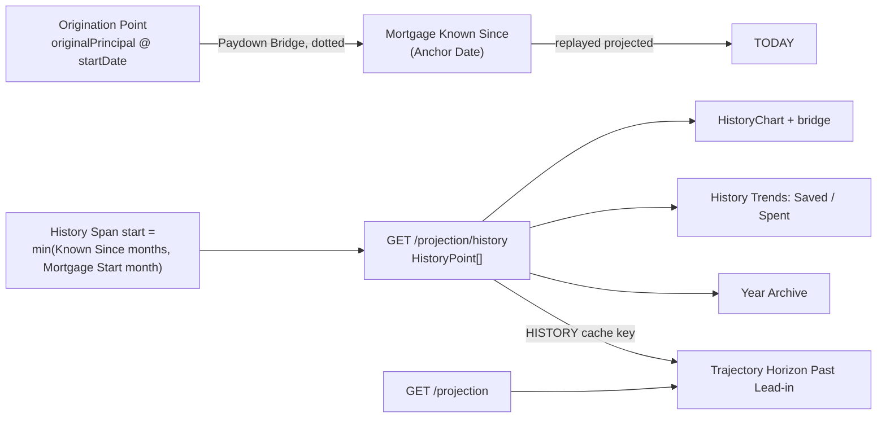

# 31 — Financial History

## Background

Horizon already looks backwards, but only as far as the imported statements
go. Live use found where that stops being enough. A 10-year mortgage is entering
year 4. Its paydown since origination is the most motivating number Horizon
could show, and nothing shows it. The History page starts at the earliest
import, and a Mortgage has no transactions, so its Known Since is its Anchor
Date. The Restschuld line therefore starts today. The Dashboard's Trajectory
Horizon starts at TODAY too. The product reads as "project the future", and
the epic repositions it as past, present and projected.

Balance Anchor (log 30) was the prerequisite. Past balances are now derived
backwards from a known point, and Unknown months are `null`, never €0.

The user approved every recommendation below in advance ("do this one alone,
i approve all your recommendations"). They also asked that the result stay
consistent with the codebase's naming, conventions, patterns and architecture.
This was therefore a solo grill: each question was settled from the code and
recorded with its recommended answer.

Code read for this session:

- `server/src/routes/projection/projection.ts:76` `GET /projection/history`.
  It returns `[]` when there are no imports. Otherwise it runs
  `projectBalances` from the earliest import `startDate` month.
- `server/src/lib/projection/history.ts` `deriveHistory`. It handles a single
  Mortgage (`accounts.find`). `restschuld` is the replayed `projected`, or
  `null` while the Mortgage's `actual` is absent (before Known Since).
  `HistoryAccount` is `{ id, kind }`.
- `server/src/lib/balanceAnchor/balanceAnchor.ts`: `balanceAt`, `knownSince`.
  A Mortgage holds no transactions, so its Known Since is its Anchor Date.
- `server/src/storage/types.ts`: Mortgage Origination is `originalPrincipal`,
  `startDate`, `termYears`. There is no interest rate. The glossary says Zinsen
  and Tilgung are not modelled.
- `src/features/history/`: `HistoryPage`, `HistoryChart` (range chips 1Y/3Y/All,
  `connectNulls={false}`, "No data before …" tooltip), `YearArchive` (only years
  with an import), and `useHistory`. `useHistory` uses a raw `fetch`, not the
  app cache. `useSavingsGoal` fetches `/projection/history` separately.
- `src/components/CacheProvider/cacheKeys.ts`: `ACCOUNTS`, `PROJECTION`,
  `CATEGORIES`, `RECURRING` plus per-month transaction keys. There is no history key.
- `src/features/projection/TrajectoryHorizon/TrajectoryHorizon.tsx`:
  `HORIZON_MONTHS = 120`, data from `/projection` starting at the current month,
  and `todayIndex` at the left edge.
- `src/utils/savingsGoal/savingsGoal.ts` `gainAt`: the month-over-month gain,
  `null` when either month is Unknown.
- `server/src/lib/variableSpending/`: `isVariableSpending` and
  `selectSpendingAccounts`, the shared Variable Spending rule behind
  `/reports/year-comparison`.

## Problem

Show where the money has been, next to where it is going. That means the
Restschuld paydown since the Mortgage Start Date, a past lead-in on the
Trajectory Horizon, and savings and spending trends over past months. Never
invent a monthly figure Horizon does not know, and never turn Unknown into €0.

## Questions and Answers

**Q1. What does Financial History deliver?**
Four slices:

1. Mortgage paydown since origination.
2. A past lead-in drawn behind the projection on the Trajectory Horizon.
3. Monthly savings and spending trends on the History page.
4. The README / CLAUDE.md pitch rewrite.

It deliberately does not include per-category trend lines, net worth, or a
month's fixed flows. The last of these is Month Cash Flow.

**Q2. How is the Restschuld known before the Mortgage's Anchor Date?**
At one point only: the **Origination Point**, which is the Original Principal
at the Mortgage Start Date. Horizon already stores it. Between the Origination
Point and the Mortgage's Known Since, the monthly path cannot be derived,
because interest is not modelled and the Anchor Gate forbids replaying
recurring before the anchor. The stretch is drawn as a **Paydown Bridge**: a
straight, dotted, faded segment between the two known points. Horizon never
presents it as a monthly value. Hovering a bridge month reads "No monthly data
· €X paid off {Mon YYYY}–{Mon YYYY}" and never shows the interpolated number.

**Q3. How does the bridge travel through the API?**
As its own `HistoryPoint` field, so the Unknown rule on `restschuld` stays
untouched:

```ts
interface HistoryPoint {
  // …existing fields unchanged
  /** Paydown Bridge: straight line Origination Point → Mortgage Known Since; null outside it. */
  restschuldBridge: number | null;
}
```

`deriveHistory` computes it on the server, which keeps log 23's fat-endpoint
rule. It is non-null from the Mortgage Start month through the Mortgage's first
known month inclusive. At that month it equals `restschuld`, so the two lines
join. The field is `null` everywhere when there is no Mortgage, no origination,
or the start month is not earlier than Known Since. `HistoryAccount` gains the
optional `originalPrincipal` and `startDate`, and the route passes the stored
accounts (a structural superset) instead of `ProjectionAccountEntry`. Nothing is
stored, so an edit in the Mortgage Modal reshapes the bridge on the next read.

**Q4. Where does the History span start?**
The **History Span** is the months `GET /projection/history` returns. It runs
from the earliest of every account's Known Since month and the Mortgage Start
month, through the current month. The `imports.length === 0 → []` guard is
replaced: the response is `[]` when the span would hold only the current month.
The **Browsable Range** (the MonthYearPicker) stays bounded by imports. A Month
Overview from before any transaction has nothing to show.

**Q5. Which years does the Year Archive list?**
Years with at least one month where a series other than the bridge is known.
That replaces "years with at least one import". The statement badge stays, and
a year with zero statements shows no badge. Years covered only by the bridge are
not listed, so the archive lists recorded data only.

**Q6. Where is the past drawn behind the projection?**
On the Trajectory Horizon, as a **Past Lead-in**. History points before the
current month are prepended to the projected data, capped at `HORIZON_MONTHS`
(120) back so that a 25-year-old mortgage cannot squash the 10-year view. The
TODAY Marker moves from the left edge to its real index. A Meridian-token
`ReferenceArea` behind the lead-in is labelled "ACTUALS". The lines keep their
colours and the Paydown Bridge is drawn as on History. The current month comes
from the projection (month 0), never from both sources. The Payoff Marker, the
Freedom Phase and ST months are forward-only and do not change. The title stays
"10-Year Projection", because the cap still bounds the window.

**Q7. How does the Dashboard get history points?**
Through the app cache:

- A `HISTORY` key is added to `cacheKeys.ts`. `useHistory` and `useSavingsGoal`
  both read it with `useCachedResource`, which replaces two raw fetches of the
  same endpoint.
- Every mutation that bumps `PROJECTION` also bumps `HISTORY`.
- The imports list `useHistory` derives years from becomes its own
  `IMPORT_HISTORY` key, bumped by import commit and delete.
- The lead-in is built by a pure `buildPastLeadIn(points, accounts)` in
  `src/utils/projection/`, beside `buildTrajectoryData`, and has a test.

**Q8. What is the savings trend?**
**Monthly Savings** is the sum of month-over-month balance gains across the
Trackable Accounts. These are the liquid and Investment accounts, the same kinds the
Savings Streak uses. It is `null` when any Trackable Account is Unknown in that
month or the month before, the same rule as the Savings Streak. It is a balance
delta, not a transaction sum, so a Recurring Transfer between two Trackable
Accounts nets to zero. A Sondertilgung paid out of them counts as money that
left savings.

**Q9. What is the spending trend?**
**Monthly Spending** is the magnitude of a month's Variable Spending outflows on
the spending accounts. It uses the shared rule in `server/src/lib/variableSpending/`,
the same one Month Year-Comparison uses, so the two can never disagree.

**Q10. Server or client for the trends?**
Server. `deriveHistory` adds `monthlySavings: number | null` and
`monthlySpending: number | null` (Q15) to `HistoryPoint`, which keeps log 23's rule that the
server owns all history derivation. The Trackable Account kinds are a domain rule
the server can own. The client's Savings Streak keeps its own `gainAt` for
per-account progress, which is a different question (per account, not summed).

**Q11. How do the trends render?**
A new **History Trends** card sits between HistoryChart and YearArchive
(`src/features/history/HistoryTrends/`, with `.styles.ts` and `.test.tsx`).
It shows:

- monthly bars, with a Saved / Spent segmented control;
- a trailing-12-month average reference line;
- Saved bars diverging on the success/error tokens;
- no bar for an Unknown month, with a tooltip that reads "No data before …";
- bars that are not clickable. Month rows in the Year Archive already go to
  `/months/:month`, and one way in is enough.

The range state moves up to `HistoryPage`, so the chart's 1Y / 3Y / All chips
govern both cards. There is no handoff bundle, so the card is composed from
existing Meridian components (`ChartFrame`, `ChartTooltip`, segmented chips),
and `ui-meridian` refines it later.

**Q12. Does Net Cashflow stay?**
Yes, unchanged. It is the sum of a month's stored transactions and is still the
"what happened" tooltip row and Year Archive column. Monthly Savings is the
balance delta of the Trackable Accounts. The two differ by design (transfers to a
Mortgage, Investment gains), and the glossary flags the distinction.

**Q13. What about months after the Anchor Date that skip recurring flows?**
Inherited, not solved. After the anchor, recurring flows are not stored (log 30
Q8), so a past month after the anchor lacks salary. Monthly Savings there reads
low until the user Re-anchors or imports that month. This belongs to Month Cash
Flow, as log 30 already recorded. The trend copy does not hide it.

**Q14. What else changes?**

- The README Project Overview and the CLAUDE.md overview are rewritten to
  "past, present and projected" in this epic's PRD, as the epic requires.
- The manual's History and Dashboard topics describe the bridge, the lead-in
  and the trends.
- The History empty-state hint reads "Import a bank statement or add your
  mortgage's origination to see your history".
- Mortgage Countdown is unchanged. It already shows % paid off against the
  Original Principal.

**Q15. Can Monthly Spending be Unknown?** _(settled at write-a-prd)_
Yes. Q4 widens the History Span back to the Mortgage Start month, which can be
years before any transaction. A plain `number` would draw €0 Spent bars across
those months, and that breaks the rule that Unknown is never €0. So
`monthlySpending` is `number | null`. It is `null` when no spending account is
known that month, and a sum (possibly a real €0) when at least one is.

**Q16. What does the HistoryChart tooltip show in a month where nothing is
known?** _(settled at write-a-prd)_
Only the Paydown Bridge row. Net Cashflow stays a `number`, as Q12 says, but the
tooltip leaves its row out in a month where every account is Unknown. Otherwise
a bridge month would read "Net Cashflow €0".

## Design



```ts
// server/src/lib/projection/history.ts
export interface HistoryPoint {
  month: string;
  totalLiquid: number | null;
  restschuld: number | null;
  restschuldBridge: number | null; // new
  netCashflow: number;
  monthlySavings: number | null; // new
  monthlySpending: number | null; // new (Q15)
  accounts: Record<string, number | null>;
}
export interface HistoryAccount {
  id: string;
  kind: AccountKind;
  originalPrincipal?: number; // new
  startDate?: string; // new
}
```

- ✅ A Paydown Bridge as its own nullable field (Q2, Q3). ❌ Writing the
  interpolation into `restschuld`: it would pass invented numbers off as known.
  ❌ An annuity curve: it needs an interest rate Horizon does not model.
  ❌ Several Restschuld readings from lender statements: these are multiple
  anchors, which log 30 Q2 rejected.
- ✅ The History Span widens to the Origination Point, and the Browsable Range
  does not (Q4). ❌ Widening the picker: months before any transaction are empty.
- ✅ A Past Lead-in capped at 120 months (Q6). ❌ An uncapped lead-in: an old
  mortgage would flatten the forward view. ❌ Merging HistoryChart into the
  Trajectory: they answer different questions, and the shared-chrome
  extraction stays deferred (log 23).
- ✅ One cached `HISTORY` resource (Q7). ❌ A third raw fetch of the same
  endpoint from the Dashboard.
- ✅ Server-derived Monthly Savings / Monthly Spending (Q10). ❌ Client
  derivation: it would duplicate the Variable Spending rule a third time.

Files touched:

- `server/src/lib/projection/history.ts` (+ `.test.ts`), `server/src/routes/projection/projection.ts` (+ `.test.ts`)
- `src/features/history/{historyTypes,HistoryChart,HistoryPage,YearArchive,useHistory}`, new `src/features/history/HistoryTrends/`
- `src/features/savings/useSavingsGoal/useSavingsGoal.ts`
- `src/components/CacheProvider/cacheKeys.ts` and every `bump(…PROJECTION)` call site, plus the import commit/delete
- `src/utils/projection/` (`buildPastLeadIn` + test), `src/features/projection/TrajectoryHorizon/`, `src/pages/DashboardPage/DashboardPage.tsx`
- `src/features/manual/manualContent/manualContent.ts`, `README.md`, `.claude/CLAUDE.md`

## Implementation Plan

1. **Paydown Bridge end to end.** `HistoryAccount` origination fields,
   `restschuldBridge` in `deriveHistory`, the History Span lower bound and empty
   rule in the route, the dotted bridge `Line` with its tooltip in HistoryChart,
   Year Archive gated on known data, and the new empty-state copy. The year-4
   mortgage shows its paydown on History.
2. **Cached history.** `HISTORY` and `IMPORT_HISTORY` keys, with `useHistory`
   and `useSavingsGoal` reading through `useCachedResource` and bumps alongside
   `PROJECTION`. Behaviour does not change, and the refetch count drops.
3. **Past Lead-in.** `buildPastLeadIn`, the ACTUALS band, the TODAY Marker at
   its real index, and the bridge on the Trajectory Horizon. `DashboardPage`
   passes the points.
4. **Trends.** `monthlySavings` / `monthlySpending` in `deriveHistory`, the
   History Trends card, and the range lifted to `HistoryPage`.
5. **Docs.** Pitch rewrite (README, CLAUDE.md), manual History and Dashboard
   topics, and build status.

## Trade-offs

- **Easier:**
  - The mortgage's whole life is visible from origination to payoff, past
    through projected, on one chart.
  - Savings and spending become trends instead of one month at a time.
  - History reads through the cache like the rest of the app.
- **Harder:**
  - A third balance-like line style (dotted bridge) needs clear copy so it is
    never read as data.
  - `HistoryPoint` grows three fields.
  - The Trajectory Horizon now has two data sources joined at the current month.
  - Monthly Savings after an Anchor Date inherits the missing-recurring gap (Q13).
- **Out of scope:**
  - Interest modelling and annuity curves.
  - Restschuld readings from lender statements (multiple anchors).
  - Multiple Mortgages in history (`deriveHistory` stays single-mortgage).
  - Per-category spending trends.
  - Net worth.
  - Widening the Browsable Range.
  - The skipped-recurring gap after the anchor (Month Cash Flow).
  - HistoryChart/Trajectory shared-chrome extraction (a later refactor plan).
