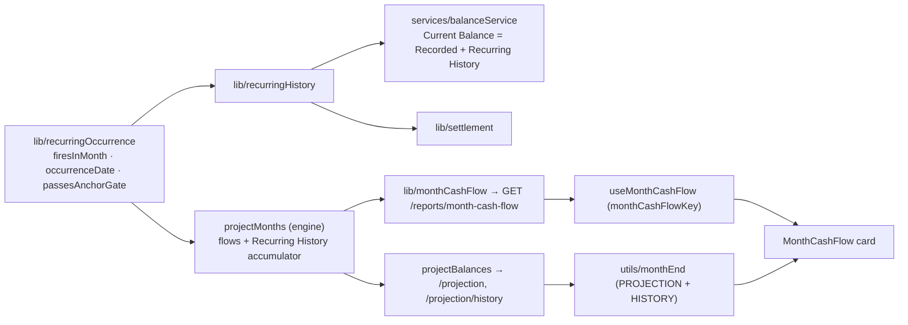

# 32 — Month Cash Flow

## Background

Since the #138 recompose (`78671d9`), Month Overview shows only Variable
Spending ("Recurring-Only Model": recurring flows live only in the projection).
So every future month reads €0 on every account, even with income, Repayment
Transfers and a November Sondertilgung set up. The epic makes the page the full
picture of one month, past or future. It adds a per-account Fixed section and a
per-account end-of-month balance; Variable Spending stays as it is.

Two earlier logs handed this epic an open gap. Log 30 Q8: after the Anchor
Date, recurring flows are never stored, and Recurring Detection pre-unchecks
their imported rows, so the **Current Balance never includes a salary paid
after the anchor**. Log 31 Q13: Monthly Savings after an anchor reads low for
the same reason. A Fixed section that lists "+€3,000 salary" above a
month-end balance that leaves it out would contradict itself, so the gap is
closed here.

The user approved every recommendation below in advance ("do this one alone,
i approve all your recommendations"). They also asked that the result stay
consistent with the codebase's naming, conventions, patterns and architecture.
This was therefore a solo grill: each question was settled from the code and
recorded with its recommended answer.

Code read for this session:

- `src/features/months/MonthOverview/MonthOverview.tsx`: PageHeader subtitle
  "Variable spending · Recurring-Only Model". The page renders MonthStatStrip,
  SpendingList (tabs only for non-Mortgage, non-Investment accounts),
  MonthBreakdown and YearComparison, each wrapped in `SectionState`.
- `src/utils/monthStats/monthStats.ts` `selectVariableSpending`: excludes
  `transferId` and `isAutoSettlement` rows.
- `server/src/lib/projection/projection.ts`:
  - `firesInMonth` is index-based. In the Forward Projection a quarterly rule
    with `monthOfYear` fires at index 0 only when the calendar month _is_
    `monthOfYear`, so the current month's quarterly occurrence is skipped
    (pinned by `projection.test.ts:815`).
  - Legacy rules without `monthOfYear` fire relative to the run's `fromDate`,
    so `/projection` and `/projection/history` can disagree about them.
  - `applyRecurringToBalances` caps a Mortgage leg at the remaining Restschuld.
  - For every month ≤ current, non-Mortgage running balances are reset to
    `actual` = `balanceAt(endOfMonth)`, which reads stored Transactions only.
    That reset throws away recurring legs after the anchor, including the
    current month's (they are in `projected` for month 0 but gone by month 1).
- `server/src/storage/sqlite/accounts.ts`: Current Balance is native SQL
  (`anchor_balance + SUM(t.amount WHERE t.date > anchor_date)`) in three
  statements (all, by id, Total Liquid).
- `server/src/services/settlementService/settlementService.ts`
  `generateSettlements`: the settlement catch-up that turns
  `computeMissingSettlements` into stored auto-settlement transfers.
- `server/src/routes/reports/reports.ts` `GET /reports/year-comparison?month=`,
  the per-month server report the Month page already reads
  (`useYearComparison`, plain fetch).
- `server/src/routes/projection/projection.ts` `GET /projection/history`: runs
  the engine from `historySpanStart` through the current month.
- `src/components/CacheProvider/cacheKeys.ts`, `useOptimisticCommit`: every
  Month page commit bumps `ACCOUNTS`, `PROJECTION`, `HISTORY`.
- `src/utils/recurring/recurring.ts` `recurringAmountFor`, `transferSideFor`:
  the signed-for-this-account rule and the Mirrored Transfer Row convention
  (log 29 Q11–13).
- `src/utils/projection/` `buildPastLeadIn` (log 31 Q6): the current month
  comes from the projection, never from both sources.

## Problem

Show, for any month and every account, the fixed flows that month carries and
the balance the account ends the month on. Past months show actual figures and
future months projected ones. Unknown is never shown as €0. The balance and the
listed flows must come from one rule, so the Fixed section, the Month-End
Balance, the Current Balance, Outlook and History can never disagree.

## Questions and Answers

**Q1. What does Month Cash Flow deliver?**
Three things:

1. A **Fixed Flows** card on Month Overview, with one group per account.
2. A **Month-End Balance** per account: actual for past months, projected for
   the current and future months, Unknown before Known Since.
3. **Recurring History** counted in every balance after the anchor, which
   closes the log 30 Q8 / log 31 Q13 gap.

It does not include:

- editing recurring rules from the Month page;
- a start-of-month balance or a reconciliation line;
- changes to MonthStatStrip, SpendingList, MonthBreakdown or YearComparison;
- showing One-off Transfers (they are invisible on the Month page today as
  well; logged as a gap);
- per-rule effective dates.

**Q2. Do recurring flows after the anchor count toward the balance?**
Yes. A recurring leg that passes the Anchor Gate and is dated on or before the
day the balance is read is **Recurring History**, and it is part of the balance:

```
Recorded Balance = anchorBalance + Σ tx where date > anchorDate          (log 30 Q4, unchanged)
Current Balance  = Recorded Balance + Recurring History (anchorDate, today]
```

This restores the glossary's original Current Balance (Anchor + Recurring
History + Variable Spending), which the storage SQL never computed. Before the
anchor nothing changes: the Anchor Gate holds, and imported statement rows stay
the history. After the anchor the rules are the record, and Recurring Detection's
pre-unchecking of matching imported rows becomes true ("already modelled")
instead of silently dropping money.

- ❌ **Booking occurrences as Transactions** (a settlement-style catch-up filling
  the vestigial `recurring_transaction_id` column). It moves the Recurring-Only
  Model into storage, needs tombstones so a deleted booking is not regenerated,
  and gives one flow two sources.
- ❌ **Leaving the gap.** A past month's Fixed rows would contradict its own
  Month-End Balance.

**Q3. Where is the Current Balance computed?**
In two layers, keeping log 30 Q5's split:

- Storage keeps the native SQL, but its result is the **Recorded Balance**:
  `AccountWithRecordedBalance.recordedBalance`.
  - `findAllWithBalance` / `findByIdWithBalance` keep their names and return
    that type.
  - `getTotalLiquid` and its SQL statement are removed.
  - `storage.parity.ts` checks `recordedBalance === balanceAt(today)`.
- A new pure lib, `server/src/lib/recurringHistory/recurringHistory.ts` (+ test),
  exports `recurringHistory(accountId, accounts, recurrings, through): number`.
  It is the signed sum of the account's gated legs in (Anchor Date, `through`].
  A Mortgage leg is capped at the remaining Restschuld, in date order.
- A new service, `server/src/services/balanceService/balanceService.ts`, follows
  the `settlementService` shape (functions taking `storage`):
  - `findAllWithBalance(storage)` and `findByIdWithBalance(storage, id)` return
    the API's unchanged `AccountWithBalance` (`balance` = Current Balance).
  - `getTotalLiquid(storage)` sums the liquid accounts' Current Balances through
    `selectLiquidAccounts`.

The accounts routes call the service instead of storage. The client contract
(`AccountWithBalance.balance`) does not change. ❌ Generating occurrences in
SQL: it would need recursive date CTEs and a second copy of the firing rule.

**Q4. One firing rule for everything?**
Yes. Firing, occurrence date and the Anchor Gate are extracted from
`projection.ts` into `server/src/lib/recurringOccurrence/recurringOccurrence.ts`
(+ test):

```ts
/** Whether a recurring fires in `month` — a pure function of the rule and the month. */
export function firesInMonth(
  r: OccurrenceRule,
  month: string,
  sourceAnchorMonth: string
): boolean;
/** The month's dayOfMonth, clamped to the month's length. */
export function occurrenceDate(month: string, dayOfMonth: number): string;
/** Anchor Gate: a leg moves its account only when dated after that account's Anchor Date. */
export function passesAnchorGate(
  anchorDate: string | undefined,
  date: string
): boolean;
```

The engine (Replay Loop and Forward Projection), `recurringHistory` and Month
Cash Flow all call it. Firing no longer depends on where a run starts:

- A calendar-aware quarterly rule fires in every month of its cycle, including
  the projection's first month. This fixes the skipped current-month occurrence;
  `projection.test.ts:815` is rewritten.
- A legacy rule without `monthOfYear` counts its index from its source account's
  Anchor month in both loops, as the Replay Loop already does.

The reason is that the Fixed section makes every month's firing visible, so an
endpoint-dependent rule would show up as a contradiction on screen.

**Q5. How do engine actuals pick up Recurring History?**
The engine keeps a per-account Recurring History accumulator. A leg that passes
the Anchor Gate adds to it, in both the Replay Loop and the Forward Projection.
For a month ≤ current:

```
actual = balanceAt(endOfMonth) + Recurring History accumulated through endOfMonth
```

The non-Mortgage reset-to-actual then keeps the current month's legs for
month 1 onwards, which fixes the drop found under Background. A Mortgage is
still not reset, but its `actual` gets the accumulator too, so
`HistoryPoint.accounts[mortgageId]` equals the replayed Restschuld from Known
Since onwards. Before the anchor the accumulator is 0, so Reconstructed Actuals
before the anchor are unchanged. Engine comments say "reset to actual", per the
Balance Anchor ambiguity note.

**Q6. Does settlement see Recurring History?**
Yes. A subscription charged to a CreditCard is a recurring flow on that card.
`settlement.ts` computes the closing balance as `balanceAt` +
`recurringHistory(…, closingDate)`, so a stored auto-settlement pulls what the
engine projects it would.

**Q7. Which rows does the Fixed section list?**
Every leg the engine applied to the account in that month, from the same run:

| Flow                                                        | Amount shown (`recurringAmountFor` convention)          | Linked line             |
| ----------------------------------------------------------- | ------------------------------------------------------- | ----------------------- |
| Plain recurring on its own account                          | stored sign (income +, expense −)                       | —                       |
| Recurring Transfer, source leg                              | −amount, red                                            | `→ ● Mortgage`          |
| Recurring Transfer, destination leg                         | +amount, green (a Repayment Transfer on a Mortgage too) | `← ● from Postbank`     |
| Repayment Transfer in the payoff month                      | capped magnitude                                        | as above                |
| CreditCard settlement (on the card and its funding account) | as booked or projected                                  | `→ ● Girokonto` / `← ●` |

- Annual and quarterly rules appear only in the months they fire.
- In the **anchor month**, legs the Anchor Gate blocks are listed muted, labelled
  "In balance anchor", and left out of the net: the user sees their salary was
  counted, not lost.
- In months **before the anchor month** no rule rows are listed. The group reads
  "Before {D MMM YYYY} this account's history comes from its statements".
- A paid-off Mortgage's capped-to-zero rule and a plain recurring on a Mortgage
  (which the engine never applies) are not listed, because they move nothing.
- Settlement rows come from stored auto-settlement Transactions for months ≤
  current, and from the engine's pending settlement for future months.

**Q8. How do the rows reach the client?**
Through a new per-month report beside the year comparison:
`GET /reports/month-cash-flow?month=YYYY-MM`, answering `400 { issues }` on a
malformed month (the reports route's existing shape).

```ts
// server/src/lib/monthCashFlow/monthCashFlow.ts
export type FixedFlowKind = "recurring" | "settlement";
export interface FixedFlow {
  kind: FixedFlowKind;
  recurringId?: string;        // kind "recurring"
  date: string;                // ISO occurrence or booking date
  description: string;
  category?: string;
  amount: number;              // signed cents for this account
  counterpartId?: string;      // the other leg's account
  side?: "source" | "destination";
  inAnchor: boolean;           // blocked by the Anchor Gate; excluded from net
}
export interface AccountFixedFlows { accountId: string; flows: FixedFlow[] }
export interface MonthCashFlowReport { month: string; accounts: AccountFixedFlows[] }
export function deriveMonthCashFlow(…): MonthCashFlowReport;
```

The route runs the same engine run as the chart that shows the month:

- a month ≥ current runs from the current month, as `/projection` does;
- a month < current runs from `historySpanStart`, as `/projection/history` does;
- a month before the History Span gets empty groups.

The engine gains an exported `projectMonths(…)`, which returns
`ProjectedMonth = MonthlySnapshot & { flows: AppliedFlow[] }`.
`projectBalances` becomes `projectMonths(…)` with `flows` dropped, so the
`/projection` payload and its tests are unchanged.
`ProjectionRecurringEntry` gains `id` in `toProjectionRecurringEntry`.
`deriveMonthCashFlow` joins description and category from the rules, adds the
stored settlements, and orders each group by date. Groups follow account
`sortOrder` and include every kind.

**Q9. Where does the Month-End Balance come from?**
From the client's already-cached `PROJECTION` and `HISTORY`, through a pure
`src/utils/monthEnd/monthEnd.ts` (+ test, exported from `utils/index.ts`):

```ts
export type MonthEndBasis = "actual" | "projected";
export type MonthEndBalance =
  | { basis: MonthEndBasis; cents: number }
  | { basis: "unknown"; knownFrom: string | null };
export function monthEndBalance(
  month: string,
  currentMonth: string,
  snapshots: MonthlySnapshot[],
  points: HistoryPoint[],
  accountId: string
): MonthEndBalance;
```

- A month ≥ current reads the projection snapshot's `projected` (basis
  "projected"). This includes the current month, whose end lies ahead.
- A month < current reads `HistoryPoint.accounts[id]`: a number is "actual",
  `null` is Unknown.
- A month that neither source covers (before the History Span, or past the
  240-month projection) is Unknown.

This follows `buildPastLeadIn`'s join rule. The Month page's own commits
already bump `PROJECTION` and `HISTORY`, so the balance moves the moment an
expense lands, and it always matches Outlook, the Trajectory Horizon and
History. ❌ Putting `endOfMonth` in the report: an extra key the commit hook
would have to bump, and a second copy of numbers the client already holds.

**Q10. How is the report cached?**
`useMonthCashFlow(month)` lives in `src/features/months/useMonthCashFlow/`
(+ test). It reads through `useCachedResource` with a branded
`monthCashFlowKey(month)` in `cacheKeys.ts`, minted the same way as
`monthTransactionsKey`, so a revisited month paints instantly and revalidates.
Month page commits do not change rules, so they do not bump it. The one
coupling, a CreditCard expense that moves a future projected settlement,
refreshes on the next visit. That is accepted and noted.

**Q11. How does the card look?**
`src/features/months/MonthCashFlow/` holds `MonthCashFlow.tsx`, `.styles.ts`,
`.test.tsx` and `MonthCashFlowSkeleton.tsx`. It is full width between
MonthStatStrip and the columns, inside its own `SectionState`
(`testId="month-section-cash-flow"`, loading = accounts + report + projection +
history). It is composed from existing parts only:

- `Card` + `SectionHead`, labelled "Fixed Flows" and titled `Fixed in {Month}`.
- One group per account, with no tabs. The account set includes Mortgage and
  Investment, which the spending tabs leave out on purpose.
- Group header: `Chip` + account name on the left. On the right, the Month-End
  Balance as `<Money>` with the caption "Month-end · Actual" or "Month-end ·
  Projected", or "No data before {Mon YYYY}" for Unknown (never €0).
- Rows: `DataRow` with the day block from SpendingList, the description, the
  linked line, and `<Money sign />` for the red/green tone.
  - Each recurring row links (`to`) to its source account page, where the rule
    is edited. This is log 29 Q12's "editable only from the source".
  - Settlement rows link to the CreditCard.
  - Muted "In balance anchor" rows use the existing dimmed treatment.
- A "Net fixed" footer sums the non-anchor rows. An account with no rows reads
  "No fixed flows this month."

`ui-meridian` refines the card later; there is no handoff bundle.

**Q12. What copy changes?**

- The PageHeader subtitle becomes "Fixed flows · Variable spending · Month-end
  balances".
- The manual's Month Overview topic gets a "Fixed flows" detail and an updated
  blurb.
- The Accounts and Getting Started copy say the balance now counts recurring
  flows since the As-of date (App-Wins Rule, log 28).
- The release notes carry a caveat: balances anchored in the past grow by the
  recurring flows since then. Re-anchor if a figure looks doubled (for example
  if salary rows after the anchor were opted back in at import).

**Q13. Does editing a rule rewrite past balances?**
Yes, and it is accepted. Rules carry no effective dates, so Recurring History
is always computed from today's rules: a raised salary also raises the months
since the anchor, and a deleted rule removes its past legs. Re-anchoring is the
correction, as it is for any drift. The manual says so. Per-rule effective dates
are out of scope and a candidate later epic.

**Q14. Is a migration needed?**
No. Recurring History is computed and nothing is stored. Only a storage DTO
field is renamed (`balance` → `recordedBalance`), with no column change.

## Design



- ✅ Recurring History counted after the anchor (Q2). ❌ Booking occurrences as
  Transactions. ❌ Leaving the gap.
- ✅ SQL Recorded Balance plus a `balanceService` (Q3). ❌ SQL occurrence
  generation.
- ✅ One index-free firing rule (Q4). ❌ Copying `firesInMonth` into the report:
  two copies of the rule would drift, the very fault this epic exposes.
- ✅ Fixed rows from the engine's applied flows (Q8). ❌ Rows rebuilt from the
  `RECURRING` cache on the client: that would reproduce the firing rule, the
  Anchor Gate and the Mortgage cap a third time.
- ✅ Month-End Balance from the cached `PROJECTION`/`HISTORY` (Q9). ❌ The
  balance in the report.
- ✅ Grouped per account, no tabs (Q11). ❌ SpendingList-style tabs: the fixed
  picture is read across accounts (a transfer's two legs), and tabs would hide
  one leg.

Files touched:

- New: `server/src/lib/{recurringOccurrence,recurringHistory,monthCashFlow}/` (+ tests), `server/src/services/balanceService/` (+ test)
- `server/src/lib/projection/projection.ts` (+ test), `server/src/lib/settlement/settlement.ts` (+ test)
- `server/src/storage/{types,Storage}.ts`, `server/src/storage/sqlite/accounts.ts`, `storage.parity.ts`
- `server/src/routes/accounts/*`, `server/src/routes/reports/reports.ts` (+ test)
- `src/components/CacheProvider/cacheKeys.ts`, `src/utils/monthEnd/` (+ test), `src/utils/index.ts`
- `src/features/months/{useMonthCashFlow,MonthCashFlow}/`, `MonthOverview.tsx`
- `src/features/manual/manualContent/manualContent.ts`, release notes, `README.md` / `.claude/CLAUDE.md` build status

## Implementation Plan

1. **Fixed rows, end to end.** Extract `recurringOccurrence`, including the
   index-free firing fix. Add `projectMonths` with `flows`,
   `deriveMonthCashFlow` (recurring rows only), `GET /reports/month-cash-flow`,
   `monthCashFlowKey`, `useMonthCashFlow`, and the MonthCashFlow card with
   source links. Opening a future month now shows its salary and transfers
   instead of €0.
2. **Month-End Balance.** `monthEndBalance`, plus group headers reading
   Actual / Projected / Unknown.
3. **Recurring History.** The engine accumulator in `actual`, `recurringHistory`,
   `balanceService` with the storage `recordedBalance` rename and parity, and
   settlement. Past months after the anchor list their legs; the anchor month
   shows muted "In balance anchor" rows; before the anchor month the
   statement-history note appears. The Dashboard balance includes the salary
   since the anchor.
4. **Settlement rows.** Stored auto-settlements for months ≤ current, and the
   engine's pending settlements for future months.
5. **Docs.** Subtitle, manual topics, release-notes caveat, glossary, and build
   status.

## Trade-offs

- **Easier:**
  - Any month reads as a whole: what comes in, what goes out, where each account
    ends.
  - The Current Balance, Outlook, History and the Month page share one firing
    rule and one Recurring History, so they cannot disagree.
  - Recurring Detection's exclusion is finally backed by the balance.
- **Harder:**
  - The balance is no longer pure SQL; a service sits between storage and the
    accounts routes.
  - Balances anchored in the past change on upgrade (release-notes caveat).
  - Editing a rule rewrites the months since the anchor (Q13).
  - A future projected settlement on the Month page refreshes only on the next
    visit (Q10).
  - The engine gains an output (`flows`) that only one report reads.
- **Out of scope:**
  - Per-rule effective dates.
  - One-off Transfers on the Month page.
  - A start-of-month balance or reconciliation line.
  - Stat-strip changes.
  - Editing rules from the Month page.
  - Multiple Mortgages.
  - Import Category Learning (the next epic), which is also what would keep
    imported salary rows before the anchor from reading as "spending".
