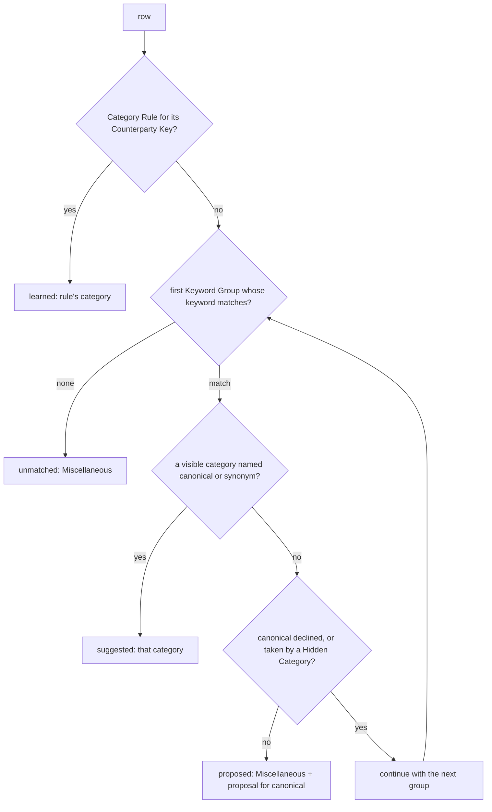

# 33 — Import Category Learning

## Background

Imported rows almost always land in Miscellaneous. The categorizer
(`server/src/lib/csvImport/categorize.ts`) is a short hardcoded keyword list,
matched only against the description, and it targets the eight Default
Categories. It predates Category Management (log 22). Log 22 made a deliberate
call: "The CSV Auto-Categorization map stays hardcoded to Default Categories —
flexibility comes from the per-row CategorySelect in the import review, not from
custom keyword rules". That flexibility is lost on every commit, because nothing
remembers a correction. The user re-fixes the same REWE rows on every
statement.

The epic is deterministic and rule-based. AI stays permanently deferred.

The user approved every recommendation below in advance ("do this one alone,
i approve all your recommendations"). They also asked that the result stay
consistent with the codebase's naming, conventions, patterns and architecture.
This was therefore a solo grill: each question was settled from the code and
recorded with its recommended answer.

Code read for this session:

- `server/src/lib/csvImport/categorize.ts`: `CATEGORY_KEYWORDS`, an ordered
  `[category, keywords[]]` list. Matching is a case-insensitive substring test
  on the description. The fallback is `"Miscellaneous"`.
- `server/src/lib/csvImport/detectStatement.ts` `mapStatementRows`: calls
  `categorize(description)` per row while mapping. This is the only call site.
- `server/src/lib/csvImport/buildPreview.ts`: pure orchestrator with injected
  I/O (`getRememberedPreset`, `existingTxns`, `recurring`). It flags
  duplicates and recurring rows after mapping.
- `server/src/lib/csvImport/bankPresets.ts`: description per preset.
  - Sparkasse uses `Beguenstigter/Zahlungspflichtiger` and Postbank giro uses
    `Begünstigter / Auftraggeber`. Both are already the counterparty.
  - Postbank CC uses `Verwendungszweck`, the merchant line. The export has no
    counterparty column.
  - Renault uses `Buchungstext`. Its counterparty `Name Zahlungsbeteiligter` is
    blank on interest and tax rows (log 21).
  - `pendingColumn` / `pendingValues` are the precedent for a preset-only
    column that the Map-columns step does not expose.
- `server/src/routes/imports/imports.ts`: the Import Commit calls
  `imports.create` and then `importPresets.upsert`.
  `server/src/routes/imports/import.ts`: `ImportRowSchema`, plus the optional,
  defaulted format fields that keep older clients committing.
- `server/src/storage/sqlite/categories.ts`: a Category is referenced by name.
  - `renameCascade` and `reassignAndDelete` are the Category Reassignment
    transactions.
  - `create` takes an optional `color` and otherwise falls back to
    `colorForCategoryName`.
  - Names collide case-insensitively.
  - A Default Category can only be recoloured or hidden.
- `server/src/storage/defaultCategories.ts`: the eight defaults.
  `server/src/storage/categoryColors.ts`: the 20-swatch palette, plus
  `fixedCategoryColors` for the prototype's names (Groceries, Dining,
  Transport, Shopping, Health).
- `src/features/import/reviewRows/reviewRows.ts`: soft **flags**
  (duplicate/recurring/pending) and hard **blockers** (description) never
  merge. `ReviewTable.tsx` renders one `CategorySelect` per row.
- `src/features/categories/CategorySelect/CategorySelect.tsx` and
  `useCategoriesWithInlineAdd`:
  - The component is uncontrolled. `initialCategory` is resolved once, after a
    per-instance `fetchCategories()`, so N review rows make N fetches.
  - The `onChange` effect fires on mount with the initial value.
  - The `CATEGORIES` cache key (`src/components/CacheProvider/cacheKeys.ts`)
    already backs `useCategories`, but not the inline-add hook.

## Problem

Make the review step's categories right, and keep them right across imports:

- Remember what the user approved.
- Fall back to a better cold-start vocabulary.
- Propose, never invent, a missing category.

Do this without a server session (Stateless Preview), without a rule editor,
and without weakening the soft-flag / hard-blocker model of log 26.

## Questions and Answers

**Q1. What is a learned rule keyed on?**
On a **Counterparty Key**: the normalised **Counterparty** of the row. It is
never keyed on the edited description, because log 26 made the description
editable inline and a key that moves with user edits would never match again.
The Counterparty is the raw source cell, taken from the **Counterparty
Column** when the preset names one and that cell is non-empty, else from the
description cell, as parsed and before any edit.

**Q2. Which presets get a Counterparty Column?**
Only Renault (`Name Zahlungsbeteiligter`). Its blank interest and tax rows fall
back to `Buchungstext`. Sparkasse and Postbank giro already map the description
to the counterparty. Postbank CC has no counterparty column, and its
`Verwendungszweck` is the merchant line. Generic has none. `counterpartyColumn`
is an optional `BankPreset` field like `pendingColumn`: preset-only and not
part of `ColumnMapping`, so the Map-columns step and the `import_presets`
JSON are untouched.

**Q3. How is the Counterparty normalised into a key?**
`counterpartyKey(raw)`:

1. Apply NFKC and lowercase.
2. Replace every run of non-letters (`[^\p{L}]+`) with a space. This drops
   digits, branch numbers, dates and reference noise.
3. Drop tokens shorter than 2 letters.
4. Keep the first `COUNTERPARTY_KEY_TOKENS = 3` tokens and join them with
   single spaces.

An empty key means "no key": nothing is looked up and nothing is learned.
Applying the function twice gives the same result as applying it once. The
token count is a named constant; build tunes it against the anonymised fixture
exports.

- ✅ Exact match on the key.
- ❌ Prefix or fuzzy matching. It is unpredictable, and with no rule editor a
  surprising match cannot be inspected or fixed outside the review step.

**Q4. Where does categorization run?**
In `buildPreview`, next to duplicate and recurring flagging. Both are
judgements "against your data". `mapStatementRows` stops categorizing:
`MappedRow` loses `category` and gains `counterparty`. `detectStatement` stays
purely about the file. The rules, the category list and the declined proposals
are injected into `BuildPreviewInput` as plain data, the same way
`existingTxns` and `recurring` are. The module stays free of storage.

**Q5. What is the precedence?**
For each row:

1. A **Category Rule** for its key. The rule is used only if the category
   still exists.
2. The first matching **Keyword Group**.
3. `Miscellaneous`.



**Q6. Are rules global, per account, or per bank?**
Global. A merchant is the same category whichever account pays it. One table
holds them, keyed by Counterparty Key.

**Q7. How are rules stored, and do they reference categories by id or by
name?**
By **name**, like Transactions and RecurringTransactions.

Migration `018_add_category_rules.sql`:

```sql
CREATE TABLE category_rules (
  counterparty_key TEXT PRIMARY KEY,
  category TEXT NOT NULL,
  updated_at TEXT NOT NULL
);
CREATE TABLE declined_category_proposals (
  name TEXT PRIMARY KEY COLLATE NOCASE
);
```

There is one repo, `CategoryRulesRepo`, in `server/src/storage/sqlite/categoryRules.ts`:

```ts
interface CategoryRule {
  counterpartyKey: string;
  category: string;
}
interface CategoryRulesRepo {
  findAll(): Promise<CategoryRule[]>;
  learn(rules: CategoryRule[]): Promise<void>; // upsert, one transaction
  findDeclined(): Promise<string[]>;
  decline(names: string[]): Promise<void>; // insert-or-ignore
}
```

It is exposed as `storage.categoryRules`. Backup, restore and reset get it for
free, because they work on the database file.

**Q8. What happens to rules when a category is renamed or deleted?**
They follow it. `renameCascade` and `reassignAndDelete` gain
`UPDATE category_rules SET category = ? WHERE category = ?`, so **Category
Reassignment** now moves Transactions, RecurringTransactions _and_ Category
Rules. Deleting a category that is not in use, without a reassignment,
deletes its rules in the same transaction. A rule therefore always names an
existing category. The preview still skips a dangling rule defensively.

**Q9. Is a rule into a Hidden Category honoured?**
Yes. Hidden is a picker filter, never a data filter (log 22), and the user
chose that category at commit. `CategorySelect` already shows a hidden current
value.

**Q10. What does "committing a row is the approval" mean exactly?**
Each preview row carries a **Category Source**:

- `learned`: a Category Rule matched.
- `suggested`: a keyword matched a visible category.
- `proposed`: a keyword matched a missing category. The row sits in
  Miscellaneous with `proposedCategory`.
- `unmatched`: the fallback Miscellaneous.
- `chosen`: the user picked the category in review.

A committed row teaches when its key is non-empty and its source is `learned`,
`suggested` or `chosen`. It does not teach when the source is `unmatched` (an
untouched fallback) or `proposed` (still undecided). This keeps a 300-row
first import from locking every unknown merchant into Miscellaneous. A user
who deliberately picks Miscellaneous does teach it (`chosen`).

**Q11. How does the commit carry what the server needs, given the Stateless
Preview?**
The commit re-sends it. `ImportRowSchema` gains `counterparty` and
`categorySource`. `ImportCreateSchema` gains `declinedProposals: string[]`.
All three are optional with defaults (`""`, `"unmatched"`, `[]`), the same
pattern as `delimiter`/`decimal`/`dateFmt`, so older clients and tests still
commit and teach nothing. The server re-derives the key with
`counterpartyKey`, which gives the same result when applied again, and never
trusts a client-computed key.

**Q12. What if one statement commits the same key into two categories?**
A pure `deriveCategoryRules(rows)` in `server/src/lib/csvImport/` resolves
it: the category with the **most** teaching rows for that key wins. A tie goes
to the row with the latest date, then to the later row in the statement. The
route learns only into categories that exist (`categories.findAll()`), then
calls `categoryRules.learn` and `categoryRules.decline` after `imports.create`.
This is the same post-create step as `importPresets.upsert`.

**Q13. How does the cold-start vocabulary deal with users who hid defaults or
renamed their world?**
The flat keyword list becomes ordered **Keyword Groups**:

```ts
interface KeywordGroup {
  category: string;
  synonyms: string[];
  keywords: string[];
}
```

A match resolves to the first **visible** category whose name equals the
group's canonical `category` or one of its `synonyms` (case-insensitive). So
`{ category: "Groceries", synonyms: ["Food"] }` suggests Food on an untouched
install and Groceries for a user who made it.

Canonical names follow the prototype where it has one: Groceries, Dining,
Transport, Shopping, Health. The rest keep the default names: Housing,
Income, Subscriptions, Entertainment, Investment, Transfer, and add
Insurance. The haystack is the lowercased raw counterparty plus description.
Matching stays a substring test. The exact keyword lists are a build detail.

**Q14. When is a category proposed rather than suggested?**
When a group matches but no visible category carries its canonical name or a
synonym. A proposal is skipped, and the next group is tried, in two cases:

- the canonical name is in `declined_category_proposals`;
- the canonical name belongs to a **Hidden Category**. Create would collide,
  and the hide was deliberate.

Proposals only ever come from the canonical names of the shipped Keyword
Groups, so Horizon never invents a category named after a merchant.

**Q15. What does the review step show?**

- **Per row:** a muted **Category Source** chip beside the CategorySelect.
  It reads "Learned", "Suggested" or "New: Transport". `chosen` and
  `unmatched` show nothing. This is a third, separate axis: never a flag (a
  reason the row was set aside) and never a blocker (a reason it cannot
  commit).
- **Above the table:** one **Category Proposal** strip per proposed category
  per statement: "New category: Transport · 6 rows — Create category /
  Dismiss".

**Q16. What do approve and dismiss do?**

- **Approve (Create category):** creates the category immediately through the
  existing `POST /categories`, with `color = nextFreeCategoryColor(categories)`
  (new pure util in `src/utils/categoryColor/`). That is the first palette
  swatch no category uses, and `colorForCategoryName` once all 20 are taken.
  The proposed rows the user has not changed move to it with source
  `suggested`, the state the next import will show them in. It is the same
  immediacy as the CategorySelect inline-add.
- **Dismiss:** affects this wizard's state only. The rows become `unmatched`
  and the name goes into `declinedProposals` on the commit.
- **Undecided at commit:** the rows commit as Miscellaneous, nothing is
  remembered, and the next statement asks again.

Commit is never gated on a proposal.

**Q17. Why does dismiss persist on commit, when approve persists at once?**
The commit is the approval moment for everything this epic remembers.
Cancelling the wizard should leave no remembered decision behind. Approve is
the exception, because a created category is a real, visible object that the
row selects need right away.

**Q18. How is a declined proposal undone?**
By creating the category by hand in Category Management. From then on the
group _suggests_ it, because suggestion only needs the category to exist.
There is no un-decline UI.

**Q19. Does a correction on one row apply to the other rows of the same
statement?**
Yes. This is **Same-Counterparty Propagation**, the learning applied at once
instead of at the next import. When the user changes a row's category:

1. That row becomes `chosen`.
2. Every other row with the same key that the user has not touched, directly
   or through propagation, gets the same category and also becomes `chosen`.

A row already touched is never overwritten. The client derives the key with a
mirrored `counterpartyKey` in `src/utils/counterpartyKey/`, which a parity
test pins to the server's, the same way `paletteMirror.test.ts` pins the
palette. The CategorySelect mount-time `onChange` must not count as a change:
`setCategory` ignores a name equal to the row's current category.

**Q20. CategorySelect is uncontrolled and fetches per row. How do approval and
propagation reach every row?**

- `CategorySelect` gains a controlled `value` (a category name) that wins over
  `initialCategory`.
- `useCategoriesWithInlineAdd` reads its list through
  `useCachedResource(CATEGORIES, …)` and bumps `CATEGORIES` after inline-add.

A category created from a proposal, or inline on one row, then appears in
every row's picker. The N per-row fetches collapse into one cached read. The
other two consumers (`TransactionCreateModal`, `RecurringTransactionModal`)
keep `initialCategory` and keep their current behaviour.

**Q21. Does deleting an import (Import Cascade Delete) unlearn its rules?**
No. Rules are knowledge, not data belonging to that statement.

**Q22. Do Month Overview edits or hand-entered Variable Spending teach?**
No. They have no Counterparty, and the epic defines the commit as the
approval. Re-categorize in Import History stays deferred.

**Q23. Is there a rule-management surface?**
No, not in this epic. The review step is where a rule is seen ("Learned") and
corrected: change the row and the commit overwrites the rule. A Category
Rules list in Category Management is a later candidate if live use asks for
one.

**Q24. What else must change so docs describe Horizon as it behaves?**

- The User Manual Import topic (`src/features/manual/`) explains the
  Learned/Suggested chips and Category Proposals.
- Glossary entries that this supersedes are updated: Auto-Categorization, the
  Default Category note on `categorize.ts`, and the log-22 relationship
  "hardcoded to Default Categories".

## Design

### Server

- ✅ `server/src/lib/csvImport/counterparty.ts`: `counterpartyKey(raw): string`
  and `COUNTERPARTY_KEY_TOKENS`.
- ✅ `server/src/lib/csvImport/categorize.ts` (rewritten):
  - `KEYWORD_GROUPS: KeywordGroup[]`
  - `categorizeRow(row, ctx): { category, categorySource, proposedCategory? }`
  - `ctx = { rules: Map<key, category>, categories: Category[], declined: Set<lowercased name> }`
  - The precedence is the one in Q5.
- ✅ `server/src/lib/csvImport/categoryRules.ts`:
  `deriveCategoryRules(rows): CategoryRule[]`, using the Q10 teach rule and
  the Q12 majority with tie-breaks.
- ✅ `MappedRow` drops `category` and gains `counterparty`. `PreviewRow` gains
  the following fields, and `BuildPreviewInput` gains `categoryRules`,
  `categories` and `declinedProposals`:

  ```ts
  category: string;
  counterparty: string;
  categorySource: CategorySource;
  proposedCategory?: string;
  ```

  `PreviewSummary` is unchanged.

- ✅ `BankPreset.counterpartyColumn?`, set on Renault only.
- ✅ `type CategorySource = "learned" | "suggested" | "proposed" | "unmatched" | "chosen"`
  in `server/src/lib/csvImport/types.ts`, mirrored in `importTypes.ts`.
- ✅ Migration `018_add_category_rules.sql`, `CategoryRulesRepo`,
  `storage.categoryRules`, and parity coverage in `storage.parity.ts`.
- ✅ The categories repo cascades into `category_rules` on rename,
  reassign-on-delete and plain delete.
- ✅ Import Commit: the optional `counterparty`, `categorySource` and
  `declinedProposals`. After `imports.create`, the route runs
  `deriveCategoryRules`, filters to existing categories, then
  `categoryRules.learn` and `categoryRules.decline`.

### Client

- ✅ `reviewRows`: `ParsedImportRow` gains `counterparty`, `categorySource` and
  `proposedCategory`. A new pure `propagateCategory(rows, id, name)` handles
  Q19.
- ✅ `src/features/import/useCategoryProposals/useCategoryProposals.ts`:
  - derives one proposal per `proposedCategory`;
  - `approve(name)` calls `createCategory` with the next free colour, bumps
    `CATEGORIES` and moves the rows;
  - `dismiss(name)` adds the name to the declined set;
  - exposes `declinedProposals` for the commit payload.
- ✅ `ReviewTable` renders the Category Source chip. `ImportWizard` renders the
  proposal strips above the table and passes the controlled `value`.
- ✅ `CategorySelect` gains the controlled `value`, and
  `useCategoriesWithInlineAdd` becomes cache-backed (Q20).
- ✅ `src/utils/counterpartyKey/` is the client mirror, plus a parity test.
  `src/utils/categoryColor/` gains `nextFreeCategoryColor`.

### Rejected alternatives

- ❌ Per-account or per-bank rules: the same merchant would need re-teaching.
- ❌ A user-mappable counterparty in `ColumnMapping`: it would change the
  Map-columns step and the stored presets for one bank's need.
- ❌ Keying on the description: it is editable in review.
- ❌ Learning from every committed row: untouched Miscellaneous would freeze
  unknown merchants.
- ❌ Gating the commit on undecided proposals: proposals are soft.
- ❌ Inventing categories from merchant names.
- ❌ An AI classifier: permanently deferred.

## Implementation Plan

1. **Learn and apply (thinnest end-to-end slice).**
   - Ship `counterpartyKey`, the `counterparty` and `categorySource` fields
     on preview and commit, migration 018 (`category_rules` only),
     `CategoryRulesRepo.findAll` and `learn`, and `deriveCategoryRules`.
   - Move categorization into `buildPreview`, with rules taking precedence
     over the current keyword list.
   - Show the "Learned" chip.
   - Commit one REWE row as Groceries; the next preview shows it Learned.
2. **Rules follow categories.** Extend Category Reassignment and delete to
   cascade into `category_rules`, and skip a dangling rule in the preview.
3. **Keyword Groups.** Replace the keyword list with canonical names,
   synonyms and visible-category resolution. Add the counterparty+description
   haystack, the Renault `counterpartyColumn` and the "Suggested" chip.
4. **Category Proposals.**
   - Add the `declined_category_proposals` table and repo methods, and the
     `proposed` source.
   - Make `CategorySelect` controlled and cache-backed.
   - Add `nextFreeCategoryColor` and `useCategoryProposals`, the proposal
     strip, and `declinedProposals` on the commit.
5. **Same-Counterparty Propagation.** Add `propagateCategory`, the client
   `counterpartyKey` mirror and parity test, and the mount-`onChange` guard.
6. **Docs in the app.** Update the User Manual Import topic.

## Trade-offs

**Easier:**

- The second import of any bank is mostly right without work.
- A correction made once is applied across the statement, and again on every
  later import.
- The cold start respects the user's own category names and hidden defaults.

**Harder:**

- A shared counterparty such as PayPal or Amazon Payments learns one category
  for every merchant behind it. The user corrects per row, and the majority
  wins.
- Card-statement merchant lines that put a city inside the first three tokens
  learn per city. Keyword Groups still catch the big chains.
- `CategorySelect` grows a controlled mode.

**Ruled out of scope:**

- A rule list or editor.
- Un-declining a proposal from a UI.
- Learning from non-import edits.
- Re-categorizing past imports.
- Prefix or fuzzy matching.
- Any AI.
