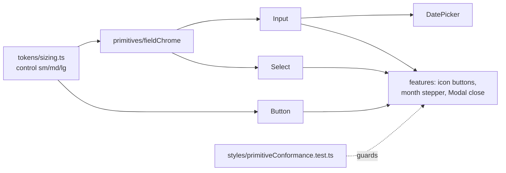

# 34 — UI Consistency Audit

## Background

Live use after 1.4.0 shows the app drifting from its own `primitives/` and
`components/`. Three symptoms reported:

- inputs side by side render at different heights,
- text that should be centred is not,
- the Month Overview month switch resizes with the month name, so the
  previous/next buttons move under the cursor while clicking through months.

The user approved every recommendation below in advance ("do this one alone,
i approve all your recommendations"), and asked that the result stay
consistent with the codebase's naming, conventions, patterns and
architecture. This was a solo grill: each question was settled from the code
and recorded with its recommended answer.

Code read for this session:

- `src/primitives/Button/Button.styles.ts`: fixed heights through a local
  `sizeHeights` map, `sm 32 / md 40 / lg 44`. `iconOnly` makes the button a
  square of the same height.
- `src/primitives/Input/Input.styles.ts`, `Select/Select.styles.ts`,
  `DatePicker/DatePicker.styles.ts`: **no height**. Each is
  `padding: space2 space3` + `line-height: 1.5` + `font-size: sm`, so its
  height is derived, not declared, and never equals the Button's 40px. The
  three duplicate the field chrome and already disagree:
  - Input and DatePicker sit on `surfaceContainerLowest`, Select on
    `surfaceContainerHigh`.
  - Input and DatePicker focus with a 2px `box-shadow`, Select with an
    `outline` offset by 2px.
  - DatePicker's `StyledDateInput` is a copy of `StyledInput` with a wider
    right padding for its calendar icon.
  - `DatePicker.styles.ts:14` interpolates `theme.typography.fontFamily`, an
    object, so the calendar's `font-family` is `[object Object]`.
- `docs/handoff/prototype/src/primitives.jsx` (the **Prototype**, source of
  truth since log 18): Button `sm 32 / md 38 / lg 44`, Input `height: 40`,
  `background: ink0`, accent border + `0 0 0 3px accentDim` focus ring.
- `src/tokens/`: `spacing`, `radius`, `typography`, `layout`, `transitions`.
  No token for a control height.
- `src/features/months/MonthOverview/MonthOverview.styles.ts`:
  `StyledStepper` / `StyledStepButton` (32×32, `border-radius: 6px`) are a
  local re-implementation of a ghost icon Button.
  `src/features/months/MonthYearPicker/MonthYearPicker.styles.ts`:
  `StyledTrigger` has `padding: 0 10px` and no width, so its width follows
  the label. This is the month-switch defect.
- Feature-local `styled.button` / `styled.input`: 38 across `features/`,
  `components/` and `layouts/`. Hand-sized icon buttons alone come in six
  sizes: 26 (`CategoryManagerModal` edit), 28 (`MonthYearPicker` year,
  `AccountCreateModal` swatch), 30 (`Modal` close, `CategoryManagerModal`,
  `MortgageCountdown`, `SavingsStreakCard`), 32 (`MonthOverview`,
  `ImportHistory`), 34 (`ManualDrawer`, `ManualSection`), 36
  (`AccountCreateModal`). `NameInput`/`AddInput` (`CategoryManagerModal`)
  and `StyledReviewDesc` (`ReviewTable`) are local text inputs.
- Literal values in `features/`, `components/`, `layouts/` styles: 57
  `font-size: Npx`, 23 `border-radius: Npx`, 64 paddings with `px`
  literals.
- `src/primitives/index.ts` does not export `Toggle` or `SwatchPicker`;
  features deep-import them.
- Test precedents: `KpiStrip.test.tsx` asserts `getComputedStyle(...).height`
  in jsdom (the #208 CLS fix), so a size can be pinned by a RED unit test.
  `src/styles/fonts.test.ts` reads source through `import.meta.glob(…,
{ query: "?raw" })`, so a test can scan style files.
- `docs/perf/` holds dated before/after evidence folders (log 27);
  `docs/live-use-defects.md` is the intake-register precedent.

## Problem

Bring every screen back onto the shared primitives and tokens, so that one
control height, one field look, one icon-button size and stable label widths
hold everywhere. Find the drift by measuring the running app, not by
eyeballing it. Fix each cause once, in the primitive or token that owns it,
and stop the drift coming back — with no behaviour, data or copy change.

## Questions and Answers

**Q1. What is in scope?**
Visual only, whole app. Surfaces: Dashboard, Accounts (and Account Detail),
Month Overview, Financial Plan, History, Import wizard (every step) and
Import History, Categories, Settings, the User Manual drawer, and every
`Modal` (the eight feature modals, `AlertModal`, `ConfirmModal`). Rest,
hover, focus-visible and disabled states count, because "consistent" includes
one focus ring. Out: behaviour, data, copy, layout redesign, new surfaces.

**Q2. What is the source of truth when the app and the Prototype disagree?**
The Prototype (log 18: "translated, never redesigned"), with one recorded
deviation: the Prototype has Button md at 38px but Input at 40px, which is
exactly the side-by-side mismatch being fixed. Horizon keeps Button md at
40px and makes every field 40px. Any other deviation found during the audit
is recorded as a finding, not decided silently.

**Q3. How is the audit run?**
Two passes, because each finds what the other cannot:

1. **Runtime pass** — the Vite dev app driven through the chrome-devtools
   MCP in Brave (port 9222), every surface in Q1 visited. `evaluate_script`
   measures `getBoundingClientRect` and `getComputedStyle` (height,
   alignment, font, radius, background, focus style) for every control and
   for siblings in one row. Screenshots of each surface.
2. **Static pass** — a sweep of `*.styles.ts` outside `primitives/` for raw
   controls (`styled.button|input|select|textarea`), hand-sized boxes, and
   literal sizes, each traced to the primitive it duplicates.

The app runs against a throwaway database (`HORIZON_DB_PATH` in the
scratchpad) filled with anonymised fixture data, never the user's real
`horizon.db` (see the "don't read real bank exports" rule).

**Q4. Where are findings recorded?**
`docs/ui-audit/findings.md`, an intake register in the shape of
`docs/live-use-defects.md`. One numbered **Audit Finding** per inconsistency:

| Field    | Content                                                    |
| -------- | ---------------------------------------------------------- |
| Screen   | the surface                                                |
| Element  | the element, by file and styled-component name             |
| Measured | the computed values that disagree                          |
| Expected | the value and the primitive or token it should come from   |
| Cause    | re-styled / re-implemented / missing primitive / token gap |
| Status   | open / fixed in `<commit>`                                 |

Before/after evidence lives beside it in `docs/ui-audit/before-<date>/` and
`docs/ui-audit/after-<date>/` (screenshots + the measurement JSON), as
`docs/perf/` does. The list is frozen when the PRD is written; anything
found later goes to `docs/live-use-defects.md` Round 2.

**Q5. How is one control height made to hold?**
A new **Control Height** token.

- ✅ `src/tokens/sizing.ts`:
  ```ts
  export const sizing = {
    // One height per control size, shared by every primitive a user can
    // type into or press, so controls side by side line up.
    control: { sm: 32, md: 40, lg: 44 },
  };
  ```
  Exported from `src/tokens/index.ts` and added to `theme`, like `radius`.
  `tokens.test.ts` pins the three values.
- `Button.styles.ts` drops its local `sizeHeights` and reads
  `theme.sizing.control[$size]`.
- `Input`, `Select` and `DatePicker` declare
  `height: theme.sizing.control[$size]` (box-sizing is already
  `border-box`, `GlobalStyle.ts:7`) and gain the same
  `size?: "sm" | "md" | "lg"` prop as Button, default `md`, so a row of
  controls is aligned by one prop.
- ❌ Fixing the padding of each field until it happens to reach 40px. The
  height stays derived and drifts again with the next font change.
- ❌ A per-feature height override. That is the drift itself.

**Q6. How do Input, Select and DatePicker stop disagreeing?**
They share one **Field Chrome**, the Prototype Input's look: `ink0`
background (`surfaceContainerLowest`), `outlineVariant` border, `radius.md`,
Control Height, accent border + `0 0 0 3px primaryContainer` focus ring,
`opacity: 0.4` when disabled.

- ✅ `src/primitives/fieldChrome/fieldChrome.ts` exports `fieldChrome`, a
  styled-components `css` fragment taking the size. Filed by the Module
  Filing Rule (a non-component module in its own folder, no barrel), and
  imported by the three primitives' `.styles.ts`.
- ✅ DatePicker's `customInput` becomes the `Input` primitive (with a
  trailing-icon slot), so `StyledDateInput` is deleted rather than kept in
  step.
- The `[object Object]` font family is fixed to
  `theme.typography.fontFamily.ui` as part of this.
- ❌ Each primitive keeps its own copy. That is how they diverged.

**Q7. What replaces the hand-sized icon buttons?**
The existing `Button`: `variant="ghost" size="sm" icon="…"` with an
`aria-label`. It is already a square of the Control Height. No new
`IconButton` primitive.

- Destructive icon actions (`CategoryManagerModal` `ActionButton $danger`,
  `ImportHistory` `StyledActionBtn $danger`) need a ghost button that turns
  `error` on hover. `Button` gains the variant `ghostDanger`, named like the
  existing single-token variants.
- `Modal`'s `StyledClose` and `ManualDrawer`'s `StyledClose` become the same
  `Button`, so every dismiss control is one size.
- Colour swatches, calendar cells, checkboxes and disclosure headers are not
  icon buttons and are judged on their own findings.

**Q8. How is the month switch fixed?**
By a rule, not a pixel value. **Stable Label Width**: a control whose label
changes when it is pressed reserves the width of its longest label, so
nothing beside it moves.

- `MonthYearPicker`'s trigger already renders in IBM Plex Mono, so `ch` is
  exact. The trigger takes `min-width` in `ch` from the longest label it can
  render, computed in the module from the month-name list (a named constant,
  not a literal), and centres its text.
- `MonthOverview`'s `StyledStepButton` becomes
  `Button variant="ghost" size="sm"`; `StyledStepper` stays as the local
  container, because it is used once.
- The `Stepper` primitive's `min-width: 2ch` already follows this rule; the
  audit checks every other changing label against it (History range, year
  headers, tab counts).

**Q9. When does a pattern earn a new primitive or component?**
When it appears in 2+ features, the same bar `src/hooks/` uses. A one-off
stays a local container composed of primitives (Q8's stepper). A primitive
goes in `primitives/` if it is an atom, `components/` if it composes
primitives, with its `.styles.ts` and `.test.tsx` beside it, exported from the
layer `index.ts`. `Toggle` and `SwatchPicker` are added to
`src/primitives/index.ts` and their deep imports switched to it.

**Q10. How is centring fixed?**
Alignment belongs to the component that owns the layout, never to the cell.
Figures stay right-aligned through `Money` in `DataRow` columns; empty and
loading states centre through `EmptyState` / `SectionState`; header and row
alignment come from one column definition so `TableHeader` and `DataRow`
cannot disagree. Each misalignment the audit measures is fixed in that
owner. A local `text-align` that duplicates the owner is removed.

**Q11. What about the 57 literal font sizes, 23 radii and 64 paddings?**
Not a blanket sweep. A literal is replaced by its token when its file is
touched by a finding and a token holds the same value (`6px` →
`radius.sm`, `16px` → `space4`). Off-scale literals that render correctly
(`13px`, `22px`) stay unless a finding measures them as inconsistent.

- ❌ Blanket token sweep: churn across ~140 lines with no visible change, and
  rounding an off-scale value onto the scale _is_ a visual change.

**Q12. How does the drift stay fixed?**
A **Primitive Conformance** test, `src/styles/primitiveConformance.test.ts`,
in the shape of `fonts.test.ts`: it reads every `*.styles.ts` under
`features/`, `components/` and `layouts/` through
`import.meta.glob(…, { query: "?raw" })` and fails on a raw
`styled.button` / `styled.input` / `styled.select` / `styled.textarea`
whose export is not in an allowlist. Each allowlist entry carries the reason
it is not a primitive (hidden file input, calendar cell, colour swatch,
disclosure header). The allowlist is a **ratchet**: written from what remains
after the fixes, it may only shrink. A new local control means either using
the primitive or adding a justified entry in review.

- ❌ An ESLint rule: `eslint.config.js` has no custom rules today, and the
  test runs in the existing `vitest run` and commit flow.
- ❌ Visual-regression screenshots: a new dependency and a flaky signal for a
  single-user app; the dated `docs/ui-audit/` evidence is the record.

**Q13. How is each fix tested?**
TDD as usual (`tdd` stops at RED). Sizes are pinned in jsdom with
`getComputedStyle`, as `KpiStrip.test.tsx` does:

- each control primitive renders at its Control Height for each size,
- a Button, Input, Select and DatePicker of one size render the same height,
- the month trigger's width is the same for "May" and "September",
- every changed feature test still finds its controls by role and label, so
  the swap to `Button` is proven behaviour-neutral.

The runtime pass is repeated after the build; the "after" measurements
replace eyeballing as the acceptance evidence.

## Design



- ✅ `src/tokens/sizing.ts` — **Control Height** (`sizing.control`).
- ✅ `src/primitives/fieldChrome/fieldChrome.ts` — **Field Chrome**.
- ✅ `Input`, `Select`, `DatePicker` — `size` prop, Control Height, Field
  Chrome; DatePicker renders `Input`.
- ✅ `Button` — reads `sizing.control`; new `ghostDanger` variant.
- ✅ Feature-local icon buttons and text inputs → `Button` / `Input`.
- ✅ `MonthYearPicker` — **Stable Label Width**.
- ✅ `src/primitives/index.ts` — exports `Toggle`, `SwatchPicker`.
- ✅ `src/styles/primitiveConformance.test.ts` — the ratchet.
- ✅ `docs/ui-audit/findings.md` + dated evidence folders.
- ❌ A new `IconButton` primitive — `Button` already is one.
- ❌ A blanket literal-to-token sweep (Q11).
- ❌ Behaviour, data or copy changes, even where the audit sees them; those
  go to `docs/live-use-defects.md`.

## Implementation Plan

1. **Audit before.** Throwaway DB with fixture data; runtime pass over every
   surface; static pass; `docs/ui-audit/findings.md` and
   `docs/ui-audit/before-<date>/`. The list freezes here and feeds the PRD.
2. **Control Height.** `sizing.ts`, Button reads it, Input/Select/DatePicker
   declare it with a `size` prop. Thinnest slice that fixes "inputs side by
   side render at different heights" everywhere at once.
3. **Field Chrome.** `fieldChrome`, DatePicker on `Input`, Select's
   background and focus aligned, the font-family bug.
4. **Month switch.** Stable Label Width on `MonthYearPicker`, step buttons on
   `Button`.
5. **Icon buttons and local inputs.** `ghostDanger`; every hand-sized icon
   button, `Modal`/`ManualDrawer` close, and local text inputs onto the
   primitives.
6. **Alignment and the remaining findings**, each in its owning primitive or
   component; `Toggle`/`SwatchPicker` barrel exports.
7. **Guard and audit after.** `primitiveConformance.test.ts` with the
   ratchet allowlist; runtime pass repeated into
   `docs/ui-audit/after-<date>/`; every finding closed with its commit.

## Trade-offs

- **Easier:** one prop aligns a row of controls; a primitive change reaches
  every screen; new drift fails a test instead of reaching live use.
- **Harder:** a feature that genuinely needs a different control must change
  or justify itself in the allowlist; `Button` grows one variant.
- **Deviation:** Button md is 40px, not the Prototype's 38px, so it matches
  the Prototype's own 40px Input.
- **Out of scope:** behaviour, data and copy; responsive breakpoints (desktop
  only); light theme (Horizon is dark-only); a token sweep with no visible
  effect; visual-regression tooling.
